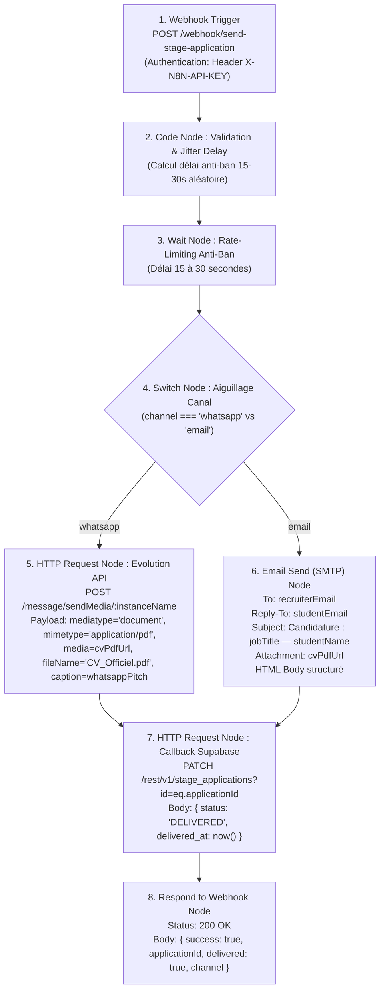

# Rapport d'Exploration — N8N Workflow, Tests E2E & Typecheck (R3 & R6)

**Auteur :** Explorer Subagent (`teamwork_preview_explorer`)  
**Date :** 2026-10-05  
**Mission :** Enquête préparatoire pour l'implémentation de l'expédition automatisée des candidatures Campus 360 (R3 : Workflow N8N & Docs, R6 : Tests E2E, Typecheck & Sécurité des secrets).  
**Statut :** Complété (Lecture Seule)

---

## 1. Synthèse Exécutive

1. **Typechecking Baseline Validé (0 Erreur) :**
   - Projet racine (Expo / React Native) : `npm run typecheck` (`node --stack_size=8192 node_modules/typescript/bin/tsc --noEmit`) s'exécute avec succès (**Code 0, 0 erreur**).
   - Backend `mobile-api` (Next.js 15) : `cd mobile-api && npm run typecheck` (`tsc --noEmit`) s'exécute avec succès (**Code 0, 0 erreur**).
2. **Architecture des Scripts & Tests Existants :**
   - Emplacement : répertoire `scripts/`.
   - Convention : Fichiers Node Native ESM (`.mjs`), assertions modulaires avec messages explicites (`✅ Test X Passed`, `❌ Test X Failed`), sortie avec `process.exit(0)` ou `process.exit(1)`.
   - Les dépendances de validation utilisent soit les built-ins Node (`crypto`, `assert`, `fs`, `path`), soit le module Zod de `mobile-api` (`../mobile-api/node_modules/zod/v3/index.js` ou packages Node standard).
3. **Écosystème N8N Existant (`scripts/n8n/`) :**
   - 5 workflows déjà opérationnels dans `scripts/n8n/` (`campus360_application_router_workflow.json`, `campus360_j7_relance_workflow.json`, `campus360_payment_webhook_workflow.json`, `campus360_treg_full_workflow.json`, `stages_ocr_ingestion_workflow.json`).
   - Format standard : Nœuds n8n officiels (`webhook v2`, `code v2`, `httpRequest v4.2`, `if v2`/`switch v3`, `wait v1.1`), variables d'environnement dynamiques (`{{ $env.VAR || fallback }}`), graphe de connexions `connections` indexé.
4. **Fichiers Cibles à Produire par les Agents d'Implémentation :**
   - `scripts/n8n/send_stage_application_workflow.json` (R3)
   - `docs/N8N_APPLICATION_DISPATCH.md` (R3)
   - `scripts/test-stage-dispatch.mjs` (R6)

---

## 2. État des Lieux des Scripts et des Tests

### 2.1 Répertoire `scripts/`
Le répertoire `scripts/` regroupe 28 scripts exécutables et 2 sous-dossiers (`agents/` et `n8n/`).

Exemples clés inspectés et exécutés lors de l'enquête :
| Fichier de script | Nature | Méthode d'exécution | Statut d'exécution |
|---|---|---|---|
| `scripts/test-stage-ingest.mjs` | Test de validation du schéma Zod d'ingestion d'offres | `node scripts/test-stage-ingest.mjs` | **Succès (Code 0)** |
| `scripts/test-payments-flow.mjs` | Test des flux Mobile Money & signatures HMAC | `node scripts/test-payments-flow.mjs` | **Succès (Code 0)** |
| `scripts/test-cv-template.mjs` | Validation du template HTML/CSS du CV officiel | `node scripts/test-cv-template.mjs` | **Succès (Code 0)** |
| `scripts/mobile-app-test-suite.mjs` | Tests de configuration EAS, manifests et templates | `node --test scripts/mobile-app-test-suite.mjs` | Compatible Node Test Runner |

### 2.2 Modèle Recommandé pour `scripts/test-stage-dispatch.mjs` (R6)
Pour être parfaitement cohérent avec la base de code, `scripts/test-stage-dispatch.mjs` doit :
- Être un script ESM autonome exécuté par `node scripts/test-stage-dispatch.mjs`.
- Utiliser `import assert from 'node:assert/strict';` ou des vérifications avec retour explicite `console.log('✅ Test X Passed...')`.
- S'assurer que le processus se termine avec `process.exit(0)` en cas de succès et `process.exit(1)` en cas d'échec.
- Ne dépendre d'aucun serveur actif externe (les réponses Evolution API et Webhook N8N doivent être testées via simulation/mock ou analyseurs de contrat de payload).

---

## 3. Analyse du Typecheck & Dépendances

### 3.1 Racine du Projet (Application Expo)
- **Fichier de configuration :** `tsconfig.json`
  - Étend : `expo/tsconfig.base`
  - Mode : `"strict": true`, `"skipLibCheck": true`
  - Exclusions : `["recruiter-web", "admin-app", "landing-site", "node_modules", "dist", ".expo", "scratch", "mobile-api", "admin", "scripts"]`
- **Script package.json :**
  ```json
  "typecheck": "node --stack_size=8192 node_modules/typescript/bin/tsc --noEmit"
  ```
- **Résultat de la vérification :** Exécuté via terminal `npm run typecheck` $\rightarrow$ **0 erreur** (Code de sortie 0).

### 3.2 Backend `mobile-api/`
- **Fichier de configuration :** `mobile-api/tsconfig.json`
  - Target : `ES2017`, Module : `esnext`, ModuleResolution : `bundler`
  - Alias : `"@/*": ["./*"]`
- **Script package.json :**
  ```json
  "typecheck": "tsc --noEmit"
  ```
- **Résultat de la vérification :** Exécuté via terminal `cd mobile-api && npm run typecheck` $\rightarrow$ **0 erreur** (Code de sortie 0).

---

## 4. Spécification Détaillée du Workflow N8N (R3)

### 4.1 Fichier : `scripts/n8n/send_stage_application_workflow.json`
Le workflow doit être un JSON n8n valide, importable directement dans une instance N8N (v1.x / v2.x).

#### A. Pipeline Visuel & Enchaînement des Nœuds


#### B. Nœuds et Paramètres Requis
1. **Webhook Trigger (`n8n-nodes-base.webhook`) :**
   - Path : `send-stage-application`
   - Method : `POST`
   - Response Mode : `responseNode`
2. **Anti-Ban Jitter & Formatting (`n8n-nodes-base.code`) :**
   - Calcule `jitterSeconds = Math.floor(Math.random() * 16) + 15;` (15 à 30 secondes).
   - Normalise le numéro WhatsApp étudiant et recruteur (`2376xxxxxxxx`).
   - Prépare le sujet et le template HTML de l'email.
3. **Wait Node (`n8n-nodes-base.wait`) :**
   - Temporisation de `{{ $json.jitterSeconds }}` secondes pour éviter les blocages de session WhatsApp en cas d'envois rapprochés.
4. **Switch Node (`n8n-nodes-base.switch`) :**
   - Règle 1 : `$json.channel === 'whatsapp'` $\rightarrow$ Sortie 0
   - Règle 2 : `$json.channel === 'email'` $\rightarrow$ Sortie 1
5. **Branche WhatsApp - Evolution API (`n8n-nodes-base.httpRequest`) :**
   - Method : `POST`
   - URL : `={{ $env.EVOLUTION_API_URL || 'https://wa.blackcompany.site' }}/message/sendMedia/{{ $json.student.instanceName || ('student-' + $json.student.phoneWhatsapp) }}`
   - Headers :
     - `apikey: ={{ $env.EVOLUTION_API_KEY || 'evolution_key_douala_2026' }}`
     - `Content-Type: application/json`
   - Body :
     ```json
     {
       "number": "={{ $json.job.recruiterWhatsapp }}",
       "mediatype": "document",
       "mimetype": "application/pdf",
       "media": "={{ $json.dossier.cvPdfUrl }}",
       "fileName": "CV_Officiel.pdf",
       "caption": "={{ $json.dossier.whatsappPitch }}"
     }
     ```
6. **Branche Email - SMTP Send (`n8n-nodes-base.emailSend` ou `httpRequest`) :**
   - To : `={{ $json.job.recruiterEmail }}`
   - Reply-To : `={{ $json.student.email }}`
   - Subject : `={{ 'Candidature : ' + $json.job.title + ' — ' + $json.student.fullName }}`
   - HTML : Corps du message avec mise en forme professionnelle, présentation du profil, lien de consultation.
   - Pièce jointe / Attachment : Document PDF officiel attaché.
7. **Callback Supabase (`n8n-nodes-base.httpRequest`) :**
   - Method : `PATCH`
   - URL : `={{ $env.SUPABASE_URL || 'https://zlzwoqqnkvxndmtnzdsm.supabase.co' }}/rest/v1/stage_applications?id=eq.{{ $json.applicationId }}`
   - Headers :
     - `apikey: ={{ $env.SUPABASE_SERVICE_ROLE_KEY }}`
     - `Authorization: ={{ 'Bearer ' + $env.SUPABASE_SERVICE_ROLE_KEY }}`
     - `Content-Type: application/json`
     - `Prefer: return=representation`
   - Body :
     ```json
     {
       "status": "DELIVERED"
     }
     ```
8. **Réponse Webhook (`n8n-nodes-base.respondToWebhook`) :**
   - Code HTTP : 200
   - JSON : `{ "success": true, "applicationId": ..., "channel": ..., "status": "DELIVERED" }`

### 4.2 Documentation : `docs/N8N_APPLICATION_DISPATCH.md`
Doit suivre le standard de `docs/N8N_PIPELINE.md` :
1. Vue d'ensemble du flux d'automatisation et diagramme Mermaid.
2. Contrat d'interface du Webhook (`POST /webhook/send-stage-application`) avec exemple exhaustif de payload (étudiant, offre, dossier PDF, pitch).
3. Configuration requise sous N8N :
   - Variables d'environnement : `EVOLUTION_API_URL`, `EVOLUTION_API_KEY`, `SUPABASE_URL`, `SUPABASE_SERVICE_ROLE_KEY`, `SMTP_HOST`, `SMTP_PORT`, `SMTP_USER`, `SMTP_PASS`.
   - Instructions pas-à-pas pour l'import JSON via l'interface N8N.
4. Stratégie de mitigation des bannissements WhatsApp (Rate-limiting queue 15-30s jitter, session multi-device légitime de l'étudiant via Evolution API, plafond de sécurité journalier).
5. Commandes de test cURL pour les deux canaux (`whatsapp` et `email`).

---

## 5. Spécification Détaillée du Script de Test (R6)

### 5.1 Fichier : `scripts/test-stage-dispatch.mjs`
Ce script servira de validateur automatique de non-régression et de certification d'assurance qualité.

### 5.2 Scénarios de Test Unitaires & d'Intégration Simulée
Le script doit exécuter les 6 assertions suivantes :

1. **Test 1 : Normalisation du numéro de téléphone & ID d'instance Evolution API**
   - Entrée : `+237 672 364 124` ou `672364124` ou `00237672364124`.
   - Résultat attendu : `237672364124` et nom d'instance `student-237672364124`.
2. **Test 2 : Format & Masquage du Pairing Code (8 chiffres)**
   - Format brut : 8 chiffres (ex: `78429012`).
   - Format d'affichage anti-saturation : `7842 - 9012`.
   - Regex de validation : `/^\d{4}\s*-\s*\d{4}$|^\d{8}$/`.
3. **Test 3 : Évaluation des États de Connexion de Session Evolution API**
   - États valides : `open` (connecté), `connecting` (en attente d'appairage), `close` (déconnecté).
   - Mapping d'interface : `open` $\rightarrow$ badge vert `✅ WhatsApp connecté` ; `close`/`connecting` $\rightarrow$ proposition d'appairage ou fallback natif.
4. **Test 4 : Validation du Payload de Dispatch N8N (Canal WhatsApp)**
   - Vérifie la conformité de l'objet transmis à Evolution API `POST /message/sendMedia/:instanceName` :
     - `mediatype`: `"document"`
     - `mimetype`: `"application/pdf"`
     - `media`: URL HTTPS valide du PDF
     - `fileName`: `"CV_Officiel.pdf"`
     - `caption`: message personnalisé d'accroche.
5. **Test 5 : Validation du Payload de Dispatch N8N (Canal Email)**
   - Vérifie la conformité de l'objet transmis au nœud SMTP :
     - `recruiterEmail`: email valide
     - `replyTo`: email personnel de l'étudiant
     - `subject`: contient l'intitulé du poste et le nom de l'étudiant
     - Pièce jointe du CV PDF.
6. **Test 6 : Vérification du Délai Anti-Ban Jitter**
   - Teste la fonction de génération aléatoire : doit produire une valeur strictement comprise entre 15 et 30 secondes.
7. **Test 7 : Audit de Non-Exposition des Secrets Côté Client**
   - Inspecte les structures de données partagées ou les objets de configuration client pour certifier qu'aucune clé privée (`EVOLUTION_API_KEY`, `SUPABASE_SERVICE_ROLE_KEY`, `DATABASE_URL`) n'est accessible côté client mobile. Seules les routes proxy de `mobile-api` doivent détenir ces secrets.

---

## 6. Alignement Schéma Base de Données (`stage_applications`)

> ⚠️ **Alerte Architecture & Recommandation pour les Implémenteurs :**
> Dans `docs/STAGES_SUPABASE.sql`, le type enum existant est :
> ```sql
> create type stage_app_status as enum ('PENDING', 'REVIEWING', 'INTERVIEW', 'ACCEPTED', 'REJECTED');
> ```
> Cependant, la spécification du module 14 et les exigences R2 & R3 mentionnent les statuts suivants :
> - `SENT_PENDING` (candidature en cours de transit vers le recruteur)
> - `DELIVERED` (candidature reçue par le recruteur via WhatsApp ou Email)
> - `FAILED` (échec de transmission)
>
> **Action requise lors de l'implémentation :**
> L'implémenteur backend doit prévoir soit une migration SQL `ALTER TYPE public.stage_app_status ADD VALUE IF NOT EXISTS 'SENT_PENDING';` (et `'DELIVERED'`, `'FAILED'`), soit gérer la compatibilité avec `'PENDING'` comme fallback lorsque l'enum restreint est actif en base.

---

## 7. Directives pour la Phase d'Implémentation

1. **Création du workflow :**
   - Écrire `scripts/n8n/send_stage_application_workflow.json` avec JSON formaté (indentation 2 espaces) et syntaxe n8n stricte.
2. **Création de la documentation :**
   - Écrire `docs/N8N_APPLICATION_DISPATCH.md` avec diagrammes Mermaid, tableaux de variables, schémas JSON et exemples cURL.
3. **Création du test automatisé :**
   - Écrire `scripts/test-stage-dispatch.mjs` sous forme de script Node ESM exécutable avec `node scripts/test-stage-dispatch.mjs`.
4. **Vérification finale obligatoire (R6) :**
   - `npm run typecheck` à la racine $\rightarrow$ 0 erreur.
   - `cd mobile-api && npm run typecheck` $\rightarrow$ 0 erreur.
   - `node scripts/test-stage-dispatch.mjs` $\rightarrow$ sortie Code 0.
