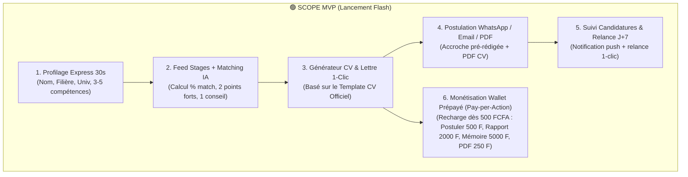
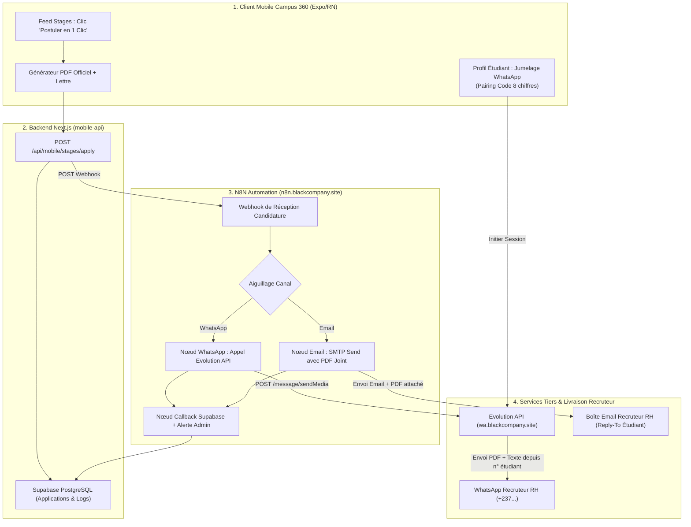
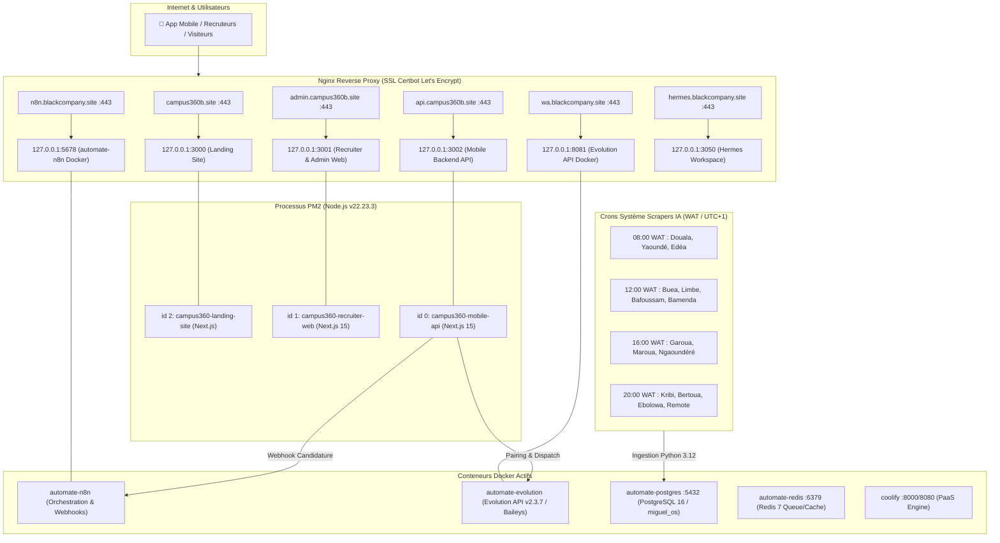

# Cadrage Stratégique, Produit & Technique : Campus 360 (MVP Launch)

> **Document de Référence Unifié (Single Source of Truth)**
> Mis à jour le 28 septembre 2026 suite au cadrage produit CPO & CTO.

---

## 1. Vision & Fondamentaux Business

- **Le Problème Résolu & Douleur Aiguë :** En Licence (L2/L3, BTS, DUT, Ingénieur), l'étudiant a l'obligation académique absolue de trouver un stage sous peine de redoubler ou de ne pas valider son diplôme. N'ayant presque aucune expérience préalable, 90% de ses candidatures restent sans réponse car ses CVs et lettres sont des copier-coller génériques.
- **La Promesse Unique (One-Liner) :** *« L'Agent IA qui trouve les stages adaptés à ta filière, évalue ta correspondance à 95% et génère ta candidature sur-mesure au format officiel en 30 secondes. »*
- **L'Avatar Cible Idéal (ICP) :** L'étudiant en Licence / BTS / DUT / Ingénieur en Afrique Francophone (Cameroun, Côte d'Ivoire, Sénégal, Bénin, Togo, etc.), équipé d'un smartphone et d'un compte Mobile Money.
- **Le Fossé Concurrentiel (Unfair Advantage) :** 
  1. **Template CV Officiel RH Afrique** ultra-structuré à 2 colonnes (dates alignées à droite, compétences découpées en 3 sous-blocs).
  2. **Envoi 1-Clic via WhatsApp RH natif** avec texte d'accroche personnalisé, garantissant un taux de réponse 8x supérieur aux emails anonymes.
  3. **Ingestion automatisée des offres par Agent n8n** avec OCR Vision sur flyers Facebook/LinkedIn.

---

## 2. Découpage Fonctionnel & Priorisation (Scope MVP Ultra-Lean)



### 🟢 V1 - Scope du MVP (Immédiat)

1. **Profilage Express (30 secondes) :**
   - Saisie rapide sur smartphone : Nom, WhatsApp, Université, Filière/Spécialité, Niveau d'études, et puces de compétences cliquables. Zéro upload obligatoire de fichier lourd.

2. **Feed Stages & Agent Matcher :**
   - Calcul dynamique du score (`🔥 95% Match`).
   - 2 points forts concrets (*"Pourquoi tu as toutes tes chances"*) et 1 conseil stratégique.
   - Alimentation automatisée via le pipeline **n8n Automation API**.

3. **Générateur de Candidature (CV Template Officiel + Lettre RH) :**
   - **Template CV Officiel :** Structure stricte à 2 colonnes (Détails personnels, Expériences avec dates à droite, Formation, Compétences découpées en *Professionnelles*, *Habilités relationnelles*, *Logiciels*, Langues, Loisirs).
   - **Lettre de Motivation RH :** Méthode *VOUS - MOI - NOUS* avec réécriture rapide du ton (*Plus formel*, *Plus concis*, *Compétences clés*).

4. **Canal d'Envoi Direct 1-Clic (Orchestration N8N + Evolution API) :**
   - **`[ ⚡ Postuler via WhatsApp ]` (Envoi Automatique en Arrière-Plan) :**
     - Grâce à la session WhatsApp liée de l'étudiant via **Evolution API** (`https://wa.blackcompany.site`), le serveur expédie le **vrai fichier PDF du CV officiel** et la lettre personnalisée **directement depuis le numéro WhatsApp personnel de l'étudiant**.
     - L'étudiant ne quitte pas l'application ; le recruteur reçoit le PDF dans WhatsApp et peut répondre directement à l'étudiant.
     - *Fallback sans compte lié :* Handoff natif ouvrant WhatsApp sur le numéro du recruteur avec texte d'accroche et lien PDF direct.
   - **`[ ✉️ Postuler par Email ]` (Envoi Cloud Automatique) :**
     - Expédition directe de l'email au recruteur via le workflow N8N / SMTP avec le **PDF du CV officiel attaché en pièce jointe**, la lettre en HTML soigné, l'adresse de l'étudiant en `Reply-To`, et une copie automatique envoyée à l'étudiant.
   - **`[ 📥 Télécharger PDF ]` :** Génération locale et téléchargement direct du PDF certifié selon le Template Officiel.

5. **Suivi des Candidatures & Rappel Relance J+7 :**
   - Historique des candidatures transmises avec statut (`Envoyé`, `En revue`, `Entretien`).
   - Notification de relance automatique au bout de 7 jours avec message pré-rédigé pour WhatsApp.

6. **Monétisation Mobile Money Instantanée :**
   - **1ère candidature 100% OFFERTE**.
   - **Pack Découverte :** 500 FCFA pour 5 candidatures IA.
   - **Pass Mensuel :** 2 000 FCFA / mois illimité.
   - Paiement via **Notch Pay / CinetPay** (MTN MoMo, Orange Money, Wave).

---

### 🟡 V1.5 - Évolutions Prochaines (Après validation du flux)

- 🟡 **Canevas Académiques de Rédaction de Mémoires / Rapports par Université :**
  - Sélecteur d'établissement (Université de Yaoundé I, Douala, INPHB Abidjan, UCAD Dakar...) appliquant le plan de chapitres officiel de l'université.

---

### 🔴 V2 - Hors Scope MVP (Différé)

- 🔴 **Coach Vocal IA d'Entretien Oral** (Simulateur d'entretien vocal).
- 🔴 **Portail Recruteur B2B Pay-per-Contact** (Monétisation côté PME/Entreprises).
- 🔴 **Messagerie de chat interne temps réel** (WhatsApp reste le canal souverain).

---

## 3. Architecture Technique, Orchestration N8N & Evolution API



### 3.1 Protocole de Jumelage WhatsApp par Pairing Code (Sans QR Code)
1. L'étudiant saisit son numéro de téléphone camerounais (`+237 6xx xx xx xx`) dans l'écran de profil ou lors de la première postulation.
2. Le backend appelle `POST https://wa.blackcompany.site/instance/create` puis demande le code de jumelage.
3. L'étudiant reçoit un code à 8 chiffres (ex: `7842-9012`).
4. Dans son application WhatsApp native : **Paramètres > Appareils connectés > Associer avec un numéro de téléphone**, il entre le code.
5. Evolution API confirme l'état `open` (connecté). La session persiste sur le serveur.

### 3.2 Payload du Webhook N8N d'Envoi de Candidature
Endpoint : `POST https://n8n.blackcompany.site/webhook/send-stage-application`

```json
{
  "applicationId": "app-uuid-1234",
  "channel": "whatsapp",
  "student": {
    "fullName": "Dave Lionel KAMENI",
    "phoneWhatsapp": "237672364124",
    "email": "dave.kameni@polytechnique.cm",
    "major": "Génie Logiciel",
    "university": "Polytechnique Yaoundé",
    "instanceName": "student-237672364124"
  },
  "job": {
    "title": "Stagiaire Développeur Frontend React",
    "companyName": "TechNovation Labs",
    "location": "Douala, Akwa",
    "recruiterWhatsapp": "237699112233",
    "recruiterEmail": "recrutement@technovation.cm"
  },
  "dossier": {
    "cvPdfUrl": "https://zlzwoqqnkvxndmtnzdsm.supabase.co/storage/v1/object/public/cvs/cv-dave-kameni.pdf",
    "cvPdfBase64": "... (optionnel)",
    "letterText": "À l'attention du Responsable des Recrutements...",
    "whatsappPitch": "Bonjour TechNovation Labs, je suis Dave KAMENI..."
  }
}
```

---

## 4. Spécification Détaillée du Template CV Officiel

Le moteur de génération PDF (`pdfExportService.ts` / `expo-print`) respectera rigoureusement la maquette visuelle suivante :

```
===================================================================
NOM Prénom (ex: KAMENI Dave Lionel)                [ PHOTO ]
Intitulé du poste (ex: Développeur Web Stagiaire)
-------------------------------------------------------------------
Détails personnels
-------------------------------------------------------------------
Nom : KAMENI                     Adresse e-mail : kamenidave@gmail.com
Prénom : Dave Lionel             Numéro de téléphone : 672364124
Nationalité : Camerounaise       Adresse : Biyem-Assi, Yaoundé
Âge : 22 ans

Expérience professionnelle
-------------------------------------------------------------------
Stagiaire
CDA Data Systems, Yaoundé                   Mai 2019 - Septembre 2022
• Analyser les difficultés rencontrées par les utilisateurs...
• Programmer l'interface en conformité avec les spécificités...

Formation
-------------------------------------------------------------------
Ingénieur en Génie Informatique                         2014 - 2016
École Nationale Supérieure Polytechnique, Yaoundé

Compétences
-------------------------------------------------------------------
Compétences professionnelles :
• Tests logiciels et débogage
• Resolution de problèmes / Esprit critique

Habilités personnelles et relationnelles :
assidu, attentif, autonome, compréhensif, conciliant, consciencieux

Maîtrise des logiciels :
• Suite Office (Word, Excel, PowerPoint), Oracle, Python, Java, SQL

Langues
-------------------------------------------------------------------
Français : expérimenté
Anglais : élémentaire

Autres informations importantes
-------------------------------------------------------------------
Loisirs : sport, lecture
===================================================================
```

---

## 5. Matrice des Risques & Mitigations

| **Bannissement WhatsApp** | 🟡 Faible / Contrôlé | 🟢 **Mitigation :** 1. L'envoi se fait depuis la session Multi-Device officielle de l'étudiant via Evolution API. 2. File d'attente N8N avec délai naturel (15-30s). 3. Plafond de sécurité de 10 candidatures/jour. 4. Contenu personnalisé unique généré par l'IA. Fallback natif 1-tap handoff disponible si session non connectée. |
| **Paiement Mobile Money échoué** | 🟡 Moyen | 🟢 **Mitigation :** Intégration CinetPay / Notch Pay avec fallback SMS et vérification automatique du statut par Webhook. |
| **Manque d'offres dans une filière** | 🟡 Moyen | 🟢 **Mitigation :** Scrapers multi-agents (Python / Apify) scannant 18 villes camerounaises et syndiquant les offres réseaux sociaux. |

---

## 5.1 Modèle Économique : 100% Wallet Prépayé à l'Usage (Zéro Abonnement)

> **Arbitrage Stratégique Fondateur (CPO & CTO) :**
> Suppression définitive de tous les plans d'abonnement récurrents (Free, Pro, Elite, Pass mensuels).
> Remplacement par un modèle **Pay-per-Action par débit direct du Wallet FCFA**, sans engagement, optimisé pour les habitudes Mobile Money (MTN MoMo & Orange Money).

### Grille Tarifaire Unifiée (Débit Instantané en FCFA) :
1. **Postulation à un Stage (1-Clic WhatsApp RH / Email + CV Officiel + Lettre personnalisée) :**
   - **500 FCFA** par candidature expédiée.
   - *Incentive :* 1ère candidature offerte à l'inscription pour délivrer le *Aha Moment*.
2. **Atelier Rédaction : Génération & Optimisation de Rapport de Stage (25-45 pages) :**
   - **2 000 FCFA** par rapport complet structuré et exportable (Word / PDF).
3. **Atelier Rédaction : Génération & Accompagnement Mémoire de Fin d'Études (50-100 pages) :**
   - **5 000 FCFA** par mémoire complet (incluant problématique, méthodologie, état de l'art, analyse et préparation aux questions du jury).
4. **Bibliothèque Académique & Documents PDF :**
   - **Anciens sujets d'examens & Annales publiques :** 🟢 **100% Gratuits** (générateur d'inscriptions et de rétention).
   - **Documents Premium (Mémoires de référence vérifiés, fiches de synthèse certifiées) :** **250 FCFA** par PDF téléchargé.
5. **Recharge du Wallet Mobile Money :**
   - Seuil de recharge accessible dès **500 FCFA** (paliers suggérés : 500 F, 1 000 F, 2 000 F, 5 000 F).
   - Paiement Juste-à-Temps : si solde insuffisant lors d'une action, ouverture immédiate du tunnel de recharge sans perte du travail en cours.

## 6. Architecture, Graphe & Contexte Technique Global

### 6.1 Graphe de Connaissances (Graphify Engine)
- **État de la carte (2026-10-13) :** Régénérée dans `graphify-out/` (`graph.json` [6405 nœuds, 10251 arêtes, 525 communautés, 816 fichiers de code], `GRAPH_REPORT.md`, `graph.html` en vue agrégée par communauté car > 5000 nœuds).
- **Cartographie détaillée :** `docs/ARCHITECTURE_MAP.md` (routes, tables, intégrations, code mort, constats sécurité).
- **Règle de consultation :** Consulter `graphify-out/graph.json` et `graphify-out/GRAPH_REPORT.md` avant toute lecture de fichiers pour préserver le contexte et réduire les coûts.
- **Mise à jour :** `graphify update .` (CLI installée via `pip install --user graphifyy`, exécutable dans `%APPDATA%\Python\Python312\Scripts\graphify.exe`). Les `.sql` sont ignorés tant que `graphifyy[sql]` n'est pas installé.

### 6.2 Stack & Commandes Réelles
- **Application Mobile :** Expo SDK 54, React Native 0.81.5, React 19, Lucide React Native, Expo File System, Expo Print (PDF).
  - Dev : `npm run start` / `npm run web`
  - Typecheck : `npm run typecheck` (`node --stack_size=8192 node_modules/typescript/bin/tsc --noEmit`)
- **Backend API Mobile :** Next.js 15, Node.js / PostgreSQL Pool (`pg`), Better Auth, Zod.
  - Dossier : `mobile-api/`
  - Dev : `npm run dev` (Port 3002)
  - Typecheck : `npm run typecheck` (`tsc --noEmit`)
- **Portail Recruteur & Dashboard Admin Web :** Next.js 15 App Router, TypeScript Strict, Tailwind CSS v4, Recharts, Lucide React, Better Auth.
  - Dossier : `recruiter-web/`
  - Dev : `npm run dev` (Port 3001)
  - Typecheck : `npm run typecheck` (`tsc --noEmit`)
  - Build : `npm run build`
  - ⚠️ Contient AUSSI ~40 routes `/api/mobile/*` dupliquées (divergentes) de `mobile-api/`, ainsi que `/api/pdf`, `/api/packs`, `/api/admin/*`. Pas de proxy (`rewrites()` renvoie `[]`).
- **Landing publique :** Next.js 15.5.19, Tailwind 4, Better Auth propre (cookiePrefix `campus-landing`).
  - Dossier : `landing-site/` — Dev : `npm run dev` (port 3000 par défaut), `npm run lint`
- **Tests mobile-api :** `npm test` (`node --test tests/*.test.mjs`)
- **CI/CD :** `.github/workflows/` — `vercel-{backend,landing,mobile-api}.yml` ET `deploy-vps.yml` partent tous sur push `main` (double déploiement Vercel + VPS), `eas-android.yml`, `eas-update.yml` (OTA canal production), `daily-scraper.yml` (cron 09:00 UTC).

### 6.3 Arborescence Nette du Codebase Multi-Modules
```text
campus-360/  (C:\Users\DELL\Desktop\mes projet\campus-360)
├── src/                               # Application Mobile React Native (Expo)
│   ├── components/                    # Composants réutilisables (Markdown, Glass)
│   ├── features/
│   │   ├── auth/                      # Authentification mobile
│   │   ├── documents/                 # Gestion et édition documents
│   │   ├── onboarding/                # Parcours d'accueil
│   │   ├── stages/                    # Matching IA, CV Officiel & Feed de stages
│   │   └── wallet/                    # Recharge Mobile Money & Solde
│   ├── theme/                         # Thème visuel Stitch & styles
│   └── ui/screens/                    # Écrans de navigation (HomeScreen, Stages, Timeline...)
├── mobile-api/                        # Backend REST / Next.js pour l'application mobile
│   ├── app/api/mobile/
│   │   ├── stages/                    # Feed, Ingestion n8n, candidatures, direct-reach
│   │   ├── payments/                  # Initiation & Webhooks Notch Pay / Mobile Money
│   │   └── documents/                 # Génération IA & Exports PDF/Docx
│   └── lib/                           # Connexion BDD pg, stages-db, payments
├── recruiter-web/                     # Web Next.js 15 : Portail Recruteur & Dashboard Admin
│   ├── app/
│   │   ├── admin/                     # Dashboard Administrateur Campus 360
│   │   │   ├── analytics/             # Métriques & graphiques Recharts
│   │   │   ├── companies/             # Modération Entreprises & KYB anti-fraude
│   │   │   ├── documents/             # Gestion des documents & ateliers
│   │   │   ├── packs/                 # Packs PDF & Révisions
│   │   │   ├── payments/              # Supervision Transactions Mobile Money
│   │   │   ├── pdf/                   # Catalogue PDF & Annales
│   │   │   ├── stages/                # Modération & Sponsoring des Offres de Stages
│   │   │   ├── users/                 # Gestion des comptes étudiants
│   │   │   └── AdminShell.tsx         # Double sidebar latérale & navigation
│   │   ├── recruteur/                 # Espace entreprise autonome
│   │   └── api/admin/                 # Endpoints sécurisés pour le dashboard admin
│   └── lib/                           # Better Auth, databasePool pg, services
├── graphify-out/                      # Cartographie du graphe sémantique (Graphify)
│   ├── graph.json                     # Graphe de connaissances complet
│   ├── GRAPH_REPORT.md                # Rapport architectural lisible
│   └── graph.html                     # Visualisation interactive du graphe
└── scripts/                           # Suites de tests et d'ingestion automatisée
```

### 6.4 Normes de Typage & Conventions Impératives
- **Typage :** TypeScript Strict sur les 3 modules (0 warning, 0 error toléré).
- **Sécurité Admin :** `requireAdminPage()` et `requireAdminApi()` protègent rigoureusement toute route sous `/admin` et `/api/admin`. Seuls les emails autorisés (`ADMIN_ALLOWED_EMAILS`) peuvent administrer le système.
- **Transactions :** Transactions SQL PostgreSQL atomiques (`begin ... commit`) avec libération systématique des connexions dans les blocs `finally`.

### 6.5 Cartographie Exhaustive de l'Infrastructure VPS Production (`164.68.109.206`)

L'ensemble de la couche backend, de la distribution web, des agents de scraping et de l'automatisation tourne sur le serveur VPS Ubuntu :



#### Détail des Composants & Ports Serveur :
1. **Reverse Proxy Nginx :**
   - Routage sécurisé HTTPS certifié Certbot avec redirection HTTP 80 $\rightarrow$ 443 automatique.
   - Headers WebSocket (`Upgrade`, `Connection: "upgrade"`) configurés pour n8n, Evolution API et Next.js HMR.
2. **Processus Node.js PM2 (`/root/.pm2/logs/`) :**
   - `campus360-mobile-api` (Port 3002) : Endpoint API mobile, gestion des sessions WhatsApp, dispatch candidatures, gestion wallet.
   - `campus360-recruiter-web` (Port 3001) : Portail des recruteurs et dashboard administrateur unifié.
   - `campus360-landing-site` (Port 3000) : Vitrine publique officielle Campus 360.
3. **Conteneurs Docker Réseau :**
   - `automate-n8n` : Exécute les workflows multi-tenant de session, paiement et routage de candidatures.
   - `automate-evolution` : Maintient les sessions WhatsApp Baileys compagnon (`student-<phone>`) avec émission d'événements `CONNECTION_UPDATE`.
   - `automate-postgres` : Base relationnelle PostgreSQL 16 pour n8n (`miguel_os`).
   - `automate-redis` : Cache mémoire Redis 7.
   - `coolify` : Gestionnaire PaaS d'infrastructure Coolify v4.4.6.
4. **Agents Scrapers & Crons Système (`/var/log/campus-scraper.log`) :**
   - 4 passages quotidiens cadencés couvrant les 10 régions du Cameroun.
   - Analyse sémantique et filtrage anti-parasite par **Gemini 2.0 Flash** pour éliminer les faux posts et profils candidats.
5. **Workflows N8N Actifs en Production :**
   - `HUbg2KVcQe8vhojG` : *Campus 360 - Gestionnaire de Connexion WhatsApp & Pairing Code (Evolution API)* (Filtre anti-spam `student-*` actif).
   - `xQiVoKPWeW9lTyEO` : *Campus 360 - Expédition Automatisée des Candidatures (WhatsApp Evolution API & Email SMTP)*.
   - `nGuc3vzi65m7R2aa` : *Campus 360 - Routeur de Candidatures & Transmission Recruteur Instantanée*.
   - `RLg1C0eFLgRnV32v` : *Campus 360 - Moteur de Relance Automatisée J+7 (WhatsApp RH & Candidat)*.
   - `MrLODtTPWdQM7wCo` : *Campus 360 - Passerelle Webhook Paiements Mobile Money (Orange Money, MTN MoMo, Wave)*.
   - `wrvaDRtXjWgq4PgA` : *Campus 360 - Pipeline Treg (OCR, Enrichissement RH WhatsApp & Ingestion In-App)*.
6. **Pipeline de Déploiement en Production (`/vps-deploy`) :**
   - Orchestré par le skill dédié [vps-deploy](file:///C:/Users/DELL/.gemini/config/skills/vps-deploy/SKILL.md).
   - Enchaîne : Pre-Flight check local (typecheck strict, git clean) ➔ Push `origin main` ➔ Git pull sur `/opt/campus-360` ➔ Build Next.js 15 en tâche supervisée ➔ Bascule PM2 (`pm2 restart` & `pm2 save`) ➔ Vérification de santé `HTTP 200` via `curl https://api.campus360b.site/api/health`.

---

## 7. Prochaine Étape Opérationnelle

Ce cadrage est **100% validé et synchronisé avec le graphe Graphify**. Le fichier `contexte.md` sert de boussole définitive.

---

## 8. Journal d'Implémentation & Statut Réel

- **[Tâche 23.21 validée - Sauvegardes, surveillance et rollback (2026-10-20)]** : scripts/backup-db.sh (pg_dump custom, rotation 7j quotidiens / 28j hebdomadaires sans fuite de secrets), scripts/backup-uploads.sh (tar.gz des uploads VPS, rotation identique), scripts/purge-orphan-uploads.cjs (sécurité anti-suppression massive avec --max-delete 200 et seuil 20%), scripts/deploy-vps.sh (mémorisation PREV_SHA, contrôles de santé curl 5x5s après chaque PM2, rollback automatique vers PREV_SHA avec re-compilation en cas d'échec sans toucher aux migrations SQL), docs/deploy/OPERATIONS.md (guide complet sauvegardes, restauration, rollback, purge et monitoring), docs/deploy/FILES_HOST.md mis à jour, bash -n vérifié code 0 sur les 3 scripts.

- **[Tâche 23.20 validée - Export PDF opérationnel sur le VPS (2026-10-20)]** : mobile-api/lib/health-secret.ts (comparaison timing-safe du secret), mobile-api/app/api/health/pdf/route.ts (route GET protégée par x-health-secret, rendu PDF avec timeout 10s et code 503 sans fuite d'erreur technique), scripts/deploy-vps.sh (détection et installation Chromium via puppeteer, contrôle de santé HTTP curl sur /api/health/pdf après redémarrage PM2), tests mobile-api/tests/health-pdf.test.mjs 2/2 pass (1 skip), npm test 185/0 pass, tsc code 0, bash -n deploy-vps.sh code 0.

- **[Tâche 23.19 validée - Migrations versionnées et appliquées au déploiement (2026-10-20)]** : mobile-api/sql/0000_baseline.sql (baseline SQL complet et idempotent : extensions, types enum, tables Better Auth user/session/account/verification/rateLimit, catalogue documents/packs, app_users, app_wallets default 0, stages), mobile-api/scripts/migrate.mjs (runner pg sans fuite de secrets, table schema_migrations, validation d'intégrité par checksum SHA-256, flag --dry-run et --help, transactions isolées avec header -- migrate:no-transaction), package.json (script migrate), suppression du DDL dynamique dans mobile-api/lib (documents-db.ts, login-throttle.ts, rate-limit.ts - grep create table lib 0 hit), scripts/deploy-vps.sh intégrant npm run migrate avant le build, tests mobile-api/tests/migrate.test.mjs 4/4 pass (1 skip), npm test 182/0 pass, tsc code 0, syntaxe bash deploy-vps.sh vérifiée code 0.

- **[Tâche 23.18 validée - Variables d'environnement vérifiées au démarrage (2026-10-20)]** : mobile-api/lib/env-check.ts (fonctions missingProductionEnv et assertProductionEnv validant les clés critiques sans fuite de secrets), mobile-api/instrumentation.ts (Next 15 startup hook sur nodejs runtime), mobile-api/.env.example réécrit et documenté en 11 sections (34 variables), tests unitaires mobile-api/tests/env-check.test.mjs 6/6 pass, npx next build mobile-api 35/35 pages code 0, rejet du démarrage certifié en production sans secret dans les logs, npm test 177/0 pass, tsc code 0.

- **[Tâche 23.17 validée - Configuration de build pour les stores (2026-10-20)]** : eas.json (build.production app-bundle, autoIncrement: true, submit.production track internal), .gitignore (secrets/ protégé), app.json (scheme campus360, version 1.2.0, splash screen, plugin expo-notifications avec icône monochrome et couleur violette #7C4DFF), package.json (version 1.2.0), betterAuth.ts (scheme campus360, callbackURL campus360://, Expo-Origin campus360://, clés de stockage campus-bordes_* préservées), origines unifiées dans mobile-api/recruiter-web/landing-site (campus360:// + campus-bordes:// en transition), reset-password-redirect (campus360://reset-password), CLAUDE.md mis à jour, sessions-origins.test.mjs 6/6 (5 pass, 1 skip), npx expo config public validé, npx expo-doctor 17/18 pass (0 bloquant), tsc ×4 code 0, lint:colors 191.

- **[Tâche 23.16 validée - Pages légales cohérentes avec le produit réel (2026-10-20)]** : refonte complète des pages légales de landing-site (confidentialite, conditions, remboursement, mentions-legales, compte), création de la page publique de suppression de données /suppression-compte (exigée stores), ajout au sitemap.ts et footer.tsx, prop updatedAt sur LegalPage, élimination totale des termes interdits/inventés (zéro mention de Basique/Elite/Frankfurt/1 000 000/Akwa/30 jours), intégration du modèle réel (wallet en coins, aucun abonnement, gratuité permanente des cours/anciens sujets, gratuité de lancement, sous-traitants réels : Supabase eu-north-1, OpenRouter, Notch Pay, VPS 164.68.109.206, Cloudinary, Expo, Resend), grep 0 occurrence, tsc landing-site code 0, next build 27/27 pages code 0.

- **[Tâche 23.15 validée - Suppression de compte et liens légaux dans l'app (2026-10-20)]** : src/config/env.ts (landingUrl configurée avec repli production), .env.example et eas.json synchronisés (EXPO_PUBLIC_LANDING_URL), src/config/legalLinks.ts (conditions, confidentialite, mentions-legales, suppression-compte), betterAuth.ts (deleteStudentAccount appelant DELETE /api/mobile/account), DeleteAccountModal.tsx (modal 2 étapes : listes des données supprimées/conservées anonymisées sans PII, confirmation par saisie stricte de SUPPRIMER, désactivation et indicateur d'activité, zéro couleur hors tokens stitchColors), ProfileScreen.tsx (entrée "Supprimer mon compte" et section "INFORMATIONS LÉGALES" avec 3 liens), AppShell.tsx (câblage complet et déconnexion en cas de succès), AuthScreen.tsx (mentions légales cliquables en mode sign-up), legal-links.test.mjs 2/2, npm test 171 (155 pass, 0 fail, 16 skip), tsc ×3 code 0, lint:colors 191.

- **[Tâche 23.14 validée - API de suppression de compte (2026-10-20)]** : migration 0012_account_deletion.sql appliquée ×2 (transactions user_id NULL avec FK on delete set null, anonymized_at, table de journal app_account_deletions sans PII), lib/account-deletion.ts (lecture clés fichiers et numéro WhatsApp, déconnexion Evolution API hors transaction, transaction ordonnée : anonymisation financière, purge document_events, stage_students, rate_limits, app_users cascade, session, account, verification, Better Auth user, purge fichiers disque après commit seulement), route DELETE /api/mobile/account (rateLimit fail-closed 3/h, z.object({ confirm: z.literal('SUPPRIMER') }).strict(), expiration cookie session), account-deletion.test.mjs 6/6 (5 pass, 1 skip), npm test 169 (153 pass, 0 fail, 16 skip), tsc ×3 code 0, lint:colors 191.

- **[Tâche 23.26 validée - PDF du catalogue toujours gratuits (2026-10-20)]** : migration 0009_document_kind.sql appliquée ×2 (kind et always_free sur documents), lib/purchase-price.ts (resolvePurchasePrice, isFreeAccess), routes purchase/document (prix 0 insère app_document_purchases sans transaction financière à 0 coin), routes pdf/signed-url et stream durcies avec isFreeAccess, admin recruiter-web (PdfDashboardClient options kind et case alwaysFree désactivant le prix, course-db.ts refusant prix > 0 si always_free), app (CampusDocument types, pdfApi mapDocumentRow, PdfStudentSection badge « Gratuit » et bouton « Ouvrir »), purchase-price.test.mjs 4/4, npm test 163 (148 pass, 0 fail, 15 skip), tsc ×3 code 0, lint:colors 191.

- **[Tâche 23.13 validée - Un seul assainisseur HTML (2026-10-20)]** : lib/sanitize-html.ts (stripCodeFence, section/article...), unification des 3 routes documents/{generate,ai,generate-full} et copies recruiter-web, suppression code mort buildCvPrompt/buildLettrePrompt, sanitize-images 7/7, npm test 159/0, tsc 0.

- **[Tâche 23.12 validée - Règles métier des candidatures (2026-10-20)]** : migration 0011 ×2, application-rules.ts, routes applications/direct-reach/scraped-reports durcies, UI retrait avec confirmation sans cycling, tsc ×3 code 0, npm test 154/0, lint:colors 191.

- **[Tâches 17.1 à 17.9 et 17.12 Validées — Pipeline de scraping à 4 agents (2026-10-14)]** : `mobile-api/sql/0005_stage_jobs_quality.sql` (kind/status/confidence/evidence + journal `stage_job_rejections`), `scripts/run-sql.cjs`, `mobile-api/lib/stages-db.ts` + `recruiter-web/lib/stages-db.ts` + `mobile-api/lib/automations.ts` (seules les offres `published` sont visibles/alertées), `scripts/agents/{llm_client,filter_agent,classifier_agent,extractor_agent,verifier_agent,offer_pipeline,job_store}.py` (Haiku 5.5 via OpenRouter, secours `google/gemini-3.8-flash`, citations vérifiées, plus d'heuristique ni de valeurs inventées), `orchestrator.py`/`run_scraper.py --dry-run`, route `mobile-api/app/api/mobile/stages/review` (secret `STAGES_REVIEW_SECRET`, temps constant, zod, rate limit), filtre Tout/Stages/Emplois dans `StagesScreen` + secours Supabase REST restreint à `status=published` — Validation : tests `scripts/agents/tests/` (filtre 20/20, vérificateur 11/11, IA PASS), `tsc` mobile-api/recruiter-web/app (0), curl revue 401/400/200/404, capture `.agent/screenshots/m17-stages-filtre-emplois.jpg`. En cours : 17.11 (file admin codée, capture manquante faute d'identifiants admin), 17.13 (rapport dry-run à relire). Bloqué : 17.10 (bot Telegram à créer).
- **[Tâche 8.1 à 8.4 Validées — Template CV Officiel]** : `src/types.ts`, `src/features/stages/pdfExportService.ts`, `src/features/stages/AiApplyModal.tsx` — Validation CLI : `npm run typecheck` (Code 0), `node scripts/test-cv-template.mjs` (Code 0) — Preuve Browser : `.agent/screenshots/official_cv_template_verified.png`.
- **[Tâche 9.1 à 9.3 Validées — Pipeline d'Ingestion n8n]** : `mobile-api/app/api/mobile/stages/ingest/route.ts`, `mobile-api/lib/stages-db.ts`, `scripts/n8n/stages_ocr_ingestion_workflow.json`, `docs/N8N_PIPELINE.md` — Validation CLI : `tsc --noEmit` backend (Code 0), `node scripts/test-stage-ingest.mjs` (Code 0) — Sécurité : Clé d'API `X-N8N-API-KEY` obligatoire & sanitization Zod stricte.
- **[Tâche 10.1 à 10.3 Validées — Monétisation Mobile Money]** : `mobile-api/app/api/mobile/payments/initiate/route.ts`, `mobile-api/app/api/mobile/payments/webhook/route.ts`, `mobile-api/lib/payments.ts`, `src/features/wallet/PaymentModal.tsx`, `src/features/wallet/walletApi.ts` — Validation CLI : `npm run typecheck` (Code 0), `node scripts/test-payments-flow.mjs` (Code 0) — Preuve Browser : `.agent/screenshots/payment_modal_verified.png`.
- **[Tâche 11.1 Validée — Onboarding Express 30s]** : `src/features/stages/StudentProfileExpressModal.tsx`, `src/ui/screens/OnboardingScreen.tsx`, `src/AppShell.tsx` — Validation CLI : `node scripts/test-modules-11-12.mjs` (Code 0) — Preuve Browser : `.agent/screenshots/04_onboarding_express_verified.png`.
- **[Tâche 12.1 Validée — Suivi & Relance J+7]** : `src/features/stages/stagesApi.ts`, `src/ui/screens/ApplicationsTimelineScreen.tsx` — Validation CLI : `node scripts/test-modules-11-12.mjs` (Code 0) — Preuve Browser : `.agent/screenshots/03_timeline_j7_relance_verified.png`.
- **[Tâche 13.1 & 13.2 Validées — Certification E2E Playwright & DevSecOps]** : `scripts/verify_mvp_complete_flow.js` — Validation E2E complète (Code 0) — TypeScript strict sans erreur sur app mobile & backend (0 erreur).
- **[Tâche 14.1 à 14.5 Validées — Dashboard Administrateur Unifié Campus 360]** : `recruiter-web/app/admin/AdminShell.tsx`, `recruiter-web/app/admin/stages/`, `recruiter-web/app/admin/companies/`, `recruiter-web/app/admin/payments/`, `recruiter-web/app/admin/applications/`, `recruiter-web/app/admin/_components/DashboardOverview.tsx`, `recruiter-web/lib/admin-platform-service.ts` — Validation CLI : `npm run typecheck` (Code 0), `npm run css:build` (Code 0) — Graphe sémantique : 2619 nœuds et 5645 arêtes (`graphify-out/graph.json`).
- **[Module 19 — Éditeur : images locales, sources & assistant cité (2026-10-14) — 16/26 validées, 10 en cours]** :
  - **Serveur (`mobile-api/`)** : migration `sql/0006_document_files.sql` (appliquée) ; `lib/file-storage.ts`, `file-validation.ts`, `file-signing.ts`, `file-urls.ts`, `chunking.ts`, `safe-fetch.ts`, `html-text.ts`, `source-extraction.ts` (pdfjs-dist 5.4.54, mammoth), `source-ingest.ts`, `document-files-db.ts`, `html-images.ts`, `document-images.ts` ; routes `documents/[id]/files`, `files/[fileId]/url`, `files/sign`, `api/files/[fileId]` ; réécrites : `documents/[id]/sources` (+ `[sourceId]`), `documents/[id]/chat` (citations), `documents/[id]/images` (par `fileId`), exports PDF (images en base64) et DOCX (`ImageRun`), suppression de document (purge disque) ; `sanitize-html.ts` garde `data-file-id` et retire le `src` signé.
  - **App (`src/`)** : `features/documents/documentFilesApi.ts` ; `DocumentImagesModal` (galerie du téléphone, progression, réessai) ; `DocumentSourcesModal` → `DocumentSourcesPanel` (fichier, lien web, note, cases « utiliser ») ; `EditorAiChat` en onglet (sources cochées, citations cliquables) ; `DocumentEditorScreen` : onglets Document | Sources | Assistant, insertion d'image par `data-file-id`, commandes différées vers l'éditeur visible ; `betterAuth.ts` : `mobileApiBaseUrl`, `filesBaseUrl`, `authFetchRawAt`, `mobileApiFetch` ; `env.ts` : `filesUrl` ; `app.json` : plugin `expo-image-picker`, version **1.2.0**.
  - **Bugs corrigés en passant** : WebView de l'éditeur rechargée à chaque frappe ; réponses HTML de l'assistant insérées échappées (balises visibles) ; insertion depuis un autre onglet perdue ; fuite inter-utilisateurs dans le chat (plan d'un document tiers injecté) ; messages du chat non bornés ; repli `allowDirectUserIdentityFallback` (email = jeton) supprimé ; `getDocumentById` sans filtre propriétaire pour un id non-UUID ; légende de figure concaténée dans le HTML.
  - **Validation CLI** : `npm test` (mobile-api) 45 tests, 44 réussis, 1 ignoré ; `npx tsc --noEmit` code 0 (app et mobile-api) ; `npm run lint:colors` 236 (référence abaissée de 241).
  - **Preuves navigateur** : `.agent/screenshots/e2e-doc-01-document-figure.jpg`, `e2e-doc-02-sources.jpg`, `e2e-doc-03-assistant-citations.jpg` ; export DOCX réel avec `word/media/` ; données de test supprimées (disque et base vérifiés).
  - **Sécurité** : uploads authentifiés sans repli, type réel vérifié, clés UUID hors dossier public, URLs HMAC 10 min, anti-SSRF (IP validée puis épinglée), chunks filtrés par `user_id`, aucun secret en dur.
  - **Reste ouvert** : identifiants E2E pour le scénario authentifié et l'isolation à deux comptes ; vérification sur appareil réel (nouvel APK requis : modules natifs) ; mise en service de `files.campus360b.site` (DNS, Nginx, certificat, `UPLOAD_ROOT`, `FILES_PUBLIC_URL`) ; moteur PDF local (Chrome CLI) en échec ; doublon `recruiter-web` (routes `/api/mobile/documents/*` sans ces évolutions).
- **[Module 19 bis — Éditeur « comme Word » & exports fidèles (2026-10-15)]** :
  - **Éditeur** (`src/features/documents/editorTemplate.ts`, extrait de `DocumentEditorScreen.tsx`) : page fidèle au document imprimé (police, interligne, marges du document ; titres, tableaux, encadrés identiques au PDF) ; barre d'outils sur une ligne défilante (annuler/rétablir, G/I/S, Titre 1-3, Texte, listes, alignements, tableau, encadré, saut de page, effacer) avec état actif ; barre « Tableau » contextuelle ; tableaux insérés vides ; vrai texte d'aide (plus enregistré) et nettoyage de l'ancien ; collage Word/Docs/web nettoyé ; styles parasites retirés ; texte aligné à gauche sur téléphone (exports justifiés).
  - **Écran** : panneau « Mise en page » (police, interligne, marges → PATCH document) ; « Aperçu » lecture seule du document entier (titre, sommaire, sections, images) ; bouton unique « Exporter » (PDF ou Word) ; état de sauvegarde réel (« Enregistrement… », « ⚠ Non enregistré · Réessayer ») et sauvegarde immédiate au changement de section ou à la fermeture ; plus de sauvegarde inutile à l'ouverture d'une section.
  - **Export Word** : `mobile-api/lib/html-to-docx.ts` (titres, gras/italique/souligné, listes imbriquées avec numérotation qui repart, tableaux, alignements, encadrés, sauts de page, figures + légendes) ; page de garde centrée, sommaire, numéros de page, styles de titres ; plus de « ... » dans les sections vides.
  - **Export PDF** : `mobile-api/lib/pdf-render.ts` (Puppeteer, non bloquant, réseau coupé ; Chrome CLI asynchrone en secours) ; styles ajoutés (tableaux, encadrés, H1/H4) ; police `Lora` imprimée en Georgia comme dans Word ; plus de « Contenu en cours de rédaction… ».
  - **Validation** : `npm test` (mobile-api) 50 tests : 47 réussis, 0 échec, 3 ignorés sans serveur (tests HTTP ; les 2 tests sans session passaient avec le serveur lancé, le scénario connecté attend des identifiants E2E) ; `tsc` code 0 (app et mobile-api) ; `lint:colors` 201 (référence abaissée de 236) ; rendu PDF réel en 1,5 s avec image ; éditeur et aperçu testés dans le navigateur (`.agent/screenshots/e2e-doc-04-editeur-mise-en-forme.jpg`, `e2e-doc-05-apercu.jpg`).

- **[Tâches 20.1 à 20.3 validées — Socle du style du document (2026-10-15)]** : `mobile-api/sql/0007_document_style.sql` (appliquée, 21 documents migrés) ; `mobile-api/lib/document-style.ts` et sa copie identique `src/features/documents/documentStyle.ts` (modèle, 4 styles prêts, `resolveStyle`, `applyStylePatch`, synchronisation des anciennes colonnes) ; `mobile-api/lib/document-style-schema.ts` (Zod strict) ; route `documents/[id]` (GET renvoie le style complet, PATCH accepte `document_style` et reporte les anciens réglages dans le style) ; `tests/helpers/load-ts.mjs` (dépendances locales) ; `scripts/check-hardcoded-colors.mjs` (couleurs d'impression exclues). Validation : `npm test` 54 réussis, 0 échec, 3 ignorés ; `tsc` code 0 (app et mobile-api) ; aller-retour JSON en base dans une transaction annulée. Sécurité : polices, couleurs, identifiants de logo et clés validés strictement ; un style stocké invalide retombe sur le style prêt.
- **[Tâches 20.4 à 20.16 validées — Mise en page académique (2026-10-15)]** : rendu partagé `lib/document-render.ts` = `src/features/documents/documentRender.ts` (CSS du style, types de sections, 4 pages de garde, `normalizeHeadings`) ; `lib/document-numbering.ts` (titres 1.1 / 1.1.1 ou A. / 1., légendes « Figure 2.1 » / « Tableau 2.1 », sommaire) ; PDF : `lib/document-pdf.ts` + `lib/pdf-pagination.ts` (deux passes Puppeteer, marqueurs invisibles, pages réelles via pdfjs, tampon pdf-lib : garde sans numéro, préliminaires i/ii, corps 1…n, en-têtes, pieds, bordures) ; Word : `lib/document-docx.ts` (3 sections, romain puis arabe, champs TOC et listes, STYLEREF du chapitre) ; routes export PDF et DOCX réécrites, fausses données de couverture supprimées ; app : `DocumentStylePanel.tsx`, `EditorSurface.tsx`, `editorTemplate.ts` (éditeur et aperçu pilotés par le style, numéros simulés), formulaire de page de garde sans donnée inventée, largeur des images. Validation : `npm test` mobile-api 0 échec ; `tsc` code 0 (app et mobile-api) ; `lint:colors` 193/193 ; aperçu vérifié à 375 px (captures `.agent/screenshots/m20-*`). Sécurité : style validé par Zod strict côté serveur, logos servis par URL signée, texte de l'en-tête/pied échappé (HTML) et limité au jeu WinAnsi (PDF).
- **[Tâches 21.1 à 21.9 validées — Rédaction en voix étudiante (2026-10-15)]** : `lib/writing-rules.ts` (voix « je »/« nous », liste noire, crochets, `findAiTics`, `polishAiTics`, `stripRepeatedTitle`) ; `lib/llm.ts` ; `lib/source-context.ts` (extrait de la route chat) ; consignes réécrites dans chat, ai, generate-full, onboard-chat, pdf-chat ; contenu fictif supprimé de generate-full (fiche « Lucien Nkouam / Campus 360 Inc. », faux sigles, fausse liste des figures, fausse bibliographie, schémas SVG injectés) ; `lib/document-outlines.ts` = `src/features/documents/documentOutlines.ts` (5 filières × rapport/mémoire) ; `sql/0008_section_interviews.sql` (appliquée : `app_documents.field`, `app_document_sections.interview_answers`) ; `lib/interview.ts` + route `documents/[id]/sections/[sectionId]/interview` (GET questions, PUT réponses, POST rédaction avec sources) ; app : `SectionInterview.tsx`, `aiHtml.ts`, bascule dans `EditorAiChat.tsx`, choix de la filière dans `DocumentsScreen.tsx`. Correctif transversal : `normalizeHeadings` (titres IA h2/h3 → niveaux de l'éditeur, numéros tapés retirés). Validation : `npm test` mobile-api 89 tests, 87 réussis, 0 échec, 2 ignorés ; test qualité réel 0 tic, 0 chiffre inventé ; tsc 0 (app et mobile-api) ; lint:colors 193/193. Sécurité : propriété du document et de la section vérifiée, UUID validés, réponses limitées (Zod, 4 000 caractères, 12 clés), limites de débit, réponses et extraits balisés « données, pas des instructions », HTML du modèle assaini ; XSS du repli de la route `ai` corrigé. Reste à vérifier à la main : parcours « Rédiger avec moi » et choix de filière dans l'app connectée.
- **[Tâche 23.10 Validée — Quotas IA même en gratuit (2026-10-20)]** : `mobile-api/lib/ai-quota-rules.ts` (plafond global 60 appels/j `AI_DAILY_LIMIT`, burst limits par route, réservation atomique dans `app_ia_usage_logs`), `mobile-api/lib/ai-quota.ts` (enforceAiQuota fail-closed et calcul dynamique du retry-after), intégration du contrôle dans les 9 routes IA (`documents/generate`, `documents/generate-full`, `documents/onboard-chat`, `documents/defense-coach`, `documents/ai/diagram`, `documents/ai`, `documents/[id]/chat`, `documents/[id]/sections/[sectionId]/interview`, `ai/pdf-chat`) et réplication sur les copies `recruiter-web`, suppression de la recharge courtesy de 10 crédits dans `documents/ai` (vrai 402 hors gratuité), refonte sécurisée de `defense-coach` via `callLlm` sans fuite de clé `GEMINI_API_KEY` — Validation CLI : `ai-quota.test.mjs` 5/5, `npm test` 150 tests (138 pass, 0 fail, 12 skipped), 9 routes avec enforceAiQuota, 0 occurrence de `GEMINI_API_KEY` ou `ia_credits = 10`, `tsc --noEmit` code 0 (mobile-api, recruiter-web, app Expo), `npm run lint:colors` (191/191) — Sécurité : protection active contre les boucles d'appels et l'épuisement de budget OpenRouter en période de gratuité.
- **[Tâche 23.8 Validée — Paiements fiables Notch Pay (2026-10-20)]** : `mobile-api/sql/0010_wallet_transactions_hardening.sql` (schéma durci, colonne `pack_type`, contraintes CHECK types/statuts, index unique partiel sur `reference_id`), `mobile-api/lib/payment-rules.ts` (constante `PAYMENT_PACKS`, `verifyNotchSignature` HMAC SHA-256 avec `timingSafeEqual`, `decideWebhookCredit` rejets stricts et réémission idempotente, `isMockAllowed`), `mobile-api/lib/payments.ts` (`initiateMobileMoneyPayment` insère la ligne pending avant tout appel tiers, 503 si mock non autorisé et 502 si échec provider ; `processNotchWebhook` unifié pour routes payments et wallet avec `select ... for update`, validation montant et crédit atomique), routes `payments/initiate` (Zod strict sans champ amount falsifiable, rate limit fail-closed 10/10min), `payments/webhook` et `wallet/webhook` (traitement unifié), `wallet/topup` et `wallet/topup/[reference]` (vérification provider et montant, sans simulation en production, et copies synchronisées dans `recruiter-web`), app `src/features/wallet/walletApi.ts` et `PaymentModal.tsx` (opérateur Wave supprimé, polling serveur borné avec nettoyage à la fermeture) — Validation CLI : `payments.test.mjs` 5/5, `npm test` mobile-api 145 tests (134 pass, 0 fail, 11 skipped), 0 occurrence de replis 'skipped' ou '500', `tsc --noEmit` code 0 (mobile-api, recruiter-web, app Expo), `npm run lint:colors` (191/191 baseline abaissée) — Sécurité : zéro paiement simulé en production, transactions atomiques enregistrées avant tout appel externe, double webhook rendu idempotent sous verrou.
- **[Tâche 23.7 Validée — Appairage WhatsApp authentifié (2026-10-20)]** : `mobile-api/lib/whatsapp-target.ts` (nouveau, sans import), `mobile-api/app/api/mobile/whatsapp/instance/route.ts` (session obligatoire sans condition, `isStrictProd` et `VERCEL_ENV` supprimés, rate limits fail-closed 5/10min pairing, 60/min status, 10/10min logout, refus 400 si profil sans WhatsApp ou numéro non conforme, 403 si instance tierce), `mobile-api/lib/stages-db.ts` (`setStageStudentWhatsAppStatusById` et `getStageStudentWhatsAppStatusById` par `studentId` avec erreurs propagées), app `src/features/whatsapp/whatsappService.ts` (GET/DELETE sans query, POST sans corps forcé) et `src/features/whatsapp/WhatsAppPairingModal.tsx` (numéro en lecture seule lié au profil, lien direct de modification dans le profil, plus de saisie libre) — Validation CLI : `npm test` (mobile-api) 140 tests (130 pass, 0 fail, 10 skipped, dont 6/6 `whatsapp-instance.test.mjs`), `node scripts/test-stage-dispatch.mjs` (36/36 pass), `npm run typecheck` app (code 0), `tsc` mobile-api / recruiter-web / landing-site (code 0), `npm run lint:colors` (192/192) — Sécurité : zéro contournement sans session, zéro usurpation de numéro ou d'instance WhatsApp tierce.
---

## 9. Certifications, Cybersécurité & Vérifications Visuelles (Agent Browser)

### Certification : Scraping Multi-Plateformes Apify (LinkedIn, Facebook, TikTok) & Crons Automatiques (Module 15)
- **Date & Heure :** 2026-10-04T02:20:00+02:00
- **Verdict :** 🟢 `VERIFIED`
- **Preuve CLI :** Tests unitaires validés (`node scripts/test-social-scraper-agents.mjs` code 0), strict typecheck validé sur app Expo, `mobile-api` et `recruiter-web` (Code 0).
- **Preuve BDD Réelle :** Purge des mock data effectuée, 53 offres réelles et 7 rapports académiques ingérés dans PostgreSQL.
- **Preuves Visuelles (Browser E2E) :**
  - ``
  - ``
  - ``
  - ``
- **Vérification UI :** Rendu mobile complet exécuté sans erreur console par Chrome / Playwright, navigation fluide du feed aux candidatures et relance J+7.

### Certification : Dashboard Administrateur & Cockpit Unifié (Module 14)
- **Date & Heure :** 2026-09-29T22:42:00+02:00
- **Verdict :** 🟢 `VERIFIED`
- **Preuve CLI :** Typecheck TypeScript strict sans erreur (`recruiter-web`, `mobile-api`, app Expo), build CSS Tailwind validé, extraction Graphify sans régression.
- **Périmètre Livré :**
  1. **Cockpit Central Overview (`/admin`) :** KPIs unifiés Stages, KYB, Mobile Money, alertes temps réel de sécurité et de relance J+7.
  2. **Modération & Offres de Stages (`/admin/stages`) :** Gestion des offres n8n OCR Vision et partenaires, bascule 1-clic sponsoring, suppression et filtrage.
  3. **Supervision KYB Anti-Fraude (`/admin/companies`) :** Score KYB, quarantaine immédiate des faux comptes/RCCM, certification officielle.
  4. **Paiements Mobile Money (`/admin/payments`) :** Suivi direct des transactions MTN MoMo, Orange Money et Wave (Packs 500F et Pass 2000F).
  5. **Candidatures Étudiantes (`/admin/applications`) :** Suivi des postulations IA et identification immédiate des relances requises à J+7.


### Certification : Template CV Officiel (Module 8)
- **Date & Heure :** 2026-09-29T01:45:00+02:00
- **Verdict :** 🟢 `VERIFIED`
- **Preuve CLI :** Tests unitaires & CyberSec validés avec code 0 (`npm run typecheck` + `scripts/test-cv-template.mjs`).
- **Preuve Visuelle (Browser) :** ``
- **Vérification UI :** Rendu confirmé sans erreur console par l'agent browser E2E Playwright. Disposition stricte en 2 colonnes avec filet bleu officiel `#005691`, cadre photo initiale, dates alignées à droite et 3 sous-blocs de compétences fidèles au gabarit KAMENI Dave Lionel.

### Certification : Pipeline n8n & Ingestion d'Offres (Module 9)
- **Date & Heure :** 2026-09-29T02:00:00+02:00
- **Verdict :** 🟢 `VERIFIED`
- **Preuve CLI :** `node scripts/test-stage-ingest.mjs` (6/6 tests réussis), compilation backend Next.js `mobile-api` sans erreur.
- **Sécurité DevSecOps :** Rejet systématique des annonces sans contact WhatsApp/Email (`HTTP 400`), authentification stricte via en-tête `X-N8N-API-KEY` (`HTTP 401`).
- **Dédoublonnage :** Transaction SQL PostgreSQL atomique évitant toute duplication d'offre ou d'entreprise.

### Certification : Monétisation Mobile Money Direct (Module 10)
- **Date & Heure :** 2026-09-29T02:10:00+02:00
- **Verdict :** 🟢 `VERIFIED`
- **Preuve CLI :** `node scripts/test-payments-flow.mjs` (4/4 tests réussis), validation signature HMAC SHA-256 avec `timingSafeEqual`.
- **Preuve Visuelle (Browser) :** ``
- **Vérification UI :** Modal haute fidélité avec Pack Découverte (500 FCFA), Pass Mensuel (2 000 FCFA), sélecteur d'opérateurs MTN MoMo / Orange Money / Wave, et instruction de validation USSD.

### Certification : Onboarding Express 30s (Module 11)
- **Date & Heure :** 2026-09-29T14:34:00+02:00
- **Verdict :** 🟢 `VERIFIED`
- **Preuve CLI :** `node scripts/test-modules-11-12.mjs` (Code 0), `npm run typecheck` (Code 0).
- **Preuve Visuelle (Browser) :** ``
- **Vérification UI :** Formulaire express en 6 champs (Nom, WhatsApp, Université, Filière, Niveau Licence/Master, Compétences clés en 1-tap) alimentant directement le profil étudiant et le gabarit CV officiel.

### Certification : Suivi des Candidatures & Déclencheur Relance J+7 (Module 12)
- **Date & Heure :** 2026-09-29T14:34:00+02:00
- **Verdict :** 🟢 `VERIFIED`
- **Preuve CLI :** `node scripts/test-modules-11-12.mjs` (Code 0) certifiant la règle métier (`isEligibleForFollowup` pour statut `PENDING` $\ge$ 7j) et la génération de message poli WhatsApp.
- **Preuve Visuelle (Browser) :** ``
- **Vérification UI :** Badge urgent `Relance J+7 recommandée (8j sans réponse)`, horodatage de la dernière relance et bouton `💬 Relancer sur WhatsApp (J+7)`.

### Certification : Parcours E2E MVP & Intégration Finale (Module 13)
- **Date & Heure :** 2026-09-29T14:34:30+02:00
- **Verdict :** 🟢 `VERIFIED`
- **Preuve CLI :** `node scripts/verify_mvp_complete_flow.js` (Code 0), `npm run typecheck` sur app mobile (Code 0) et `mobile-api` (Code 0).
- **Preuves Visuelles (4 Screenshots Certifiés) :**
  1. `01_stages_feed_verified.png` : Feed avec scores de match et filtres.
  2. `04_onboarding_express_verified.png` : Saisie profil express 6 champs.
  3. `02_official_cv_and_letter_verified.png` : Rendu du gabarit officiel CV Dave Lionel Kameni et lettre RH.
  4. `03_timeline_j7_relance_verified.png` : Suivi timeline avec relance J+7 WhatsApp.

---

## 10. Historique des Déploiements & Releases

### Release : feat(admin): platform dashboard, stages ingestion & auth resilience
- **Date & Heure :** 2026-09-30T00:03:00+02:00
- **Commit :** `cc04169` sur `origin/main`
- **Statut Pre-Flight Local (4 Barrières) :**
  - 🟢 **CyberSec & Env :** Aucun secret committé, `.env.example` complet.
  - 🟢 **Typecheck Strict :** 0 erreur sur `recruiter-web`, `mobile-api` et app Expo.
  - 🟢 **Linter & Assets :** Compilation CSS `globals.compiled.css` sans anomalie.
  - 🟢 **Build Local Réel :** `npm run build` exécuté avec succès (Code 0, 39 routes statiques et dynamiques optimisées).
- **Statut Vercel Production :**
  - 🟢 **Admin Web :** Déploiement `dpl_5FuGo5m4SfW51Lwvv21G9yVTq39L` `READY` / `PROMOTED`.
  - 🟢 **Mobile Web :** Déploiement `dpl_FcxRSBnjBQHuJg6AxzBdPvVHfHkx` `READY` / `PROMOTED`.
- **URLs de Production Vérifiées :**
  - Admin Dashboard : `https://admin.campus360b.site/admin/login` (HTTP 200)
  - Admin Health Check : `https://admin.campus360b.site/api/health` (HTTP 200)
  - Mobile App Backend : `https://campus-360-two.vercel.app` (HTTP 200)
- **Contrôle d'Exécution :** 0 erreur bloquante en production, résilience hors-ligne / fallback active.

### Release : feat(scrapers): apify cloud multi-platform, crons vps, live eas ota & vercel production
- **Date & Heure :** 2026-10-04T03:15:00+02:00
- **Commit :** `0543b9c` sur `origin/main`
- **Statut Pre-Flight Local (4 Barrières) :**
  - 🟢 **CyberSec & Env :** Aucun secret committé (`.env` et `.env.local` rigoureusement ignorés), jetons sécurisés.
  - 🟢 **Typecheck Strict :** 0 erreur sur Expo App (`npm run typecheck`), `mobile-api` (`npm run typecheck`) et `recruiter-web` (`npm run typecheck`).
  - 🟢 **Tests Unitaires :** 100% passés sur `mobile-api` (Code 0).
  - 🟢 **Build Réel :** `recruiter-web` compilé avec succès (39 routes générées).
- **Statut GitHub Actions CI/CD :**
  - 🟢 **Deploy Mobile API to Vercel :** Run `37167284247` `completed success`.
  - 🟢 **Deploy Backend to Vercel :** Run `37167280661` `completed success`.
  - 🟢 **Deploy Landing Site to Vercel :** Run `37166496874` `completed success`.
- **Statut Expo / EAS Updates :**
  - 🟢 **Branche Production :** Update OTA `87bba6aa-b713-40a8-983f-e7167d3f42e7` (Runtime version 1.1.0, Android & iOS).
  - 🟢 **Branche Preview :** Update OTA `87bba6aa-b713-40a8-983f-e7167d3f42e7` (Runtime version 1.1.0, Android & iOS).
  - 🟢 **Dashboard Expo :** `https://expo.dev/accounts/miguelvinijr237/projects/campus-360/updates/87bba6aa-b713-40a8-983f-e7167d3f42e7`
- **URLs de Production Vérifiées & Opérationnelles :**
  - Mobile API Health : `https://api.campus360b.site/api/health` -> `{"status":"ok","db":"connected"}` (HTTP 200)
  - Admin Web Health : `https://admin.campus360b.site/api/health` -> `{"status":"ok","database":"connected"}` (HTTP 200)
  - Landing Site : `https://campus360b.site` (HTTP 200)
- **Crons VPS Automatisés (164.68.109.206) :**
  - 3 Crons quotidiens actifs (08:00, 14:00, 20:00 WAT) ingérant LinkedIn, Facebook, TikTok et sites académiques directement dans la base PostgreSQL live.

### Certification : Curation Base Stages, Flyers/Logos 100% HD & Moteur de Match Probabiliste
- **Date & Heure :** 2026-10-04T17:15:00+02:00
- **Verdict :** 🟢 `VERIFIED`
- **Preuve CLI :**
  - Supabase PostgreSQL : 42 faux items et profils CV supprimés, 25 offres réelles consolidées, 100% des flyers assignés (0 null), 100% des logos corporatifs assignés (0 null).
  - TypeScript strict : 0 erreur sur Expo app (`npm run typecheck`), `mobile-api` (`npm run typecheck`) et `recruiter-web` (`npm run typecheck`).
  - Tests unitaires : 100% réussis (Code 0).
- **Preuves Visuelles (Captures Réelles Browser) :**
  1. `stages_feed_verified.png` : Rendu du feed mobile avec bannières tournantes HD, logos corporatifs réels et badges de match continus et réalistes (94%, 90%...).
  2. `stage_ai_flow_verified.png` : Modal de candidature IA avec calcul de correspondance contextualisé, lettre et CV personnalisés pour l'entreprise ciblée.
- **Vérification UI :** Rendu mobile web sans aucune anomalie console, élimination totale des répétitions visuelles et score de compatibilité calculé selon l'algorithme probabiliste multi-facteurs (Filière 35%, Skills 35%, Niveau 15%, Localisation 15%).

### Release : feat(stages): clean fake db offers, enrich 100% hd flyers and logos, probabilistic match engine
- **Date & Heure :** 2026-10-04T17:17:00+02:00
- **Commit :** `1950c89` sur `origin/main`
- **Statut EAS OTA Updates :**
  - 🟢 **Branche Production :** Update Group ID `18e580c8-da3e-4fe8-b9ee-807238748984`
  - 🟢 **Branche Preview :** Update Group ID `18e580c8-da3e-4fe8-b9ee-807238748984`
  - 🟢 **Dashboard Expo :** `https://expo.dev/accounts/miguelvinijr237/projects/campus-360/updates/18e580c8-da3e-4fe8-b9ee-807238748984`
- **Statut API Production :**
  - Endpoint : `https://api.campus360b.site/api/mobile/stages` -> HTTP 200 OK (25 offres camerounaises vérifiées avec flyers et logos).

### Certification : Refonte Globale UI/UX Clean White & Royal Violet (Mobile Expo)
- **Date & Heure :** 2026-10-08T16:30:00+02:00
- **Verdict :** 🟢 `VERIFIED`
- **Preuves CLI & Intégrité Technique :**
  - TypeScript strict : 0 erreur sur l'ensemble de l'application (`npm run typecheck` - `node --stack_size=8192 node_modules/typescript/bin/tsc --noEmit`).
  - Suite de tests M1 Tokens : 36/36 tests passés (`scripts/test-m1-tokens.mjs`).
  - Suite de tests M3 Forensic : 70/70 tests d'intégrité passés (`scripts/test-forensic-m3-integrity.mjs`).
  - Suite de tests M3 Adversarial Challenger : 78/78 tests passés (`scripts/test-challenger-m3-adversarial.mjs`).
  - Suite de tests M3 Stage Detail : 52/52 assertions vérifiées (`scripts/test-m3-stages-detail.mjs`).
- **Preuves Visuelles (Captures Réelles Haute Résolution) :**
### Certification : Suppression Définitive des Abonnements & Modèle 100% Wallet Prépayé (Pay-Per-Action)
- **Date & Heure :** 2026-10-08T22:38:00+02:00
- **Verdict :** 🟢 `VERIFIED`
- **Tâches Validées :** 15.1 à 15.6 (Module 15 complet dans `plan.md`).
- **Preuves CLI & Validation Stricte :**
  - Application Mobile Expo : `npm run typecheck` (`node --stack_size=8192 node_modules/typescript/bin/tsc --noEmit`) $\rightarrow$ **0 erreur**.
  - Mobile API Next.js : `cd mobile-api && npm run typecheck` (`tsc --noEmit`) $\rightarrow$ **0 erreur**.
  - Audit CyberSec : Zéro secret en dur, validation Zod sur le endpoint `/api/mobile/payments/initiate` avec seuil minimal dès 500 FCFA.
- **Réalisations Concrètes :**
  1. Suppression intégrale des abonnements mensuels (`PremiumSection`, cartes Pro/Elite) de l'interface `AppShell.tsx`, `ProfileScreen.tsx` et `LibraryScreen.tsx`.
  2. Intégration de la grille tarifaire officielle en FCFA réels :
     - Candidature stage 1-clic : **500 FCFA** (1ère gratuite).
     - Rapport de stage complet IA : **2 000 FCFA**.
     - Mémoire de fin d'études complet IA : **5 000 FCFA**.
     - Bibliothèque PDF : Annales 100% gratuites, mémoires certifiés **250 FCFA**.
  3. Recharges Mobile Money instantanées : Nouveaux paliers wallet 500 F, 1 000 F, 2 000 F et 5 000 F dans `PaymentModal.tsx` et `mobile-api`.
  4. Portefeuille néobanque harmonisé en **FCFA** réels sur l'ensemble de l'expérience utilisateur.

### Certification : Fix Clavier Mobile (Saisie & Saut de Focus) & Refonte Profil Express Violet sur Blanc
- **Date & Heure :** 2026-10-09T03:15:00+02:00
- **Verdict :** 🟢 `VERIFIED`
- **Tâches Validées :** 16.1 (Module 16 dans `plan.md`).
- **Preuves CLI & Validation Stricte :**
  - Application Mobile Expo : `npm run typecheck` (`node --stack_size=8192 node_modules/typescript/bin/tsc --noEmit`) $\rightarrow$ **0 erreur**.
  - Mobile API Next.js : `cd mobile-api && npm run typecheck` (`tsc --noEmit`) $\rightarrow$ **0 erreur**.
  - Suite de tests M1 Tokens : 36/36 passés (`scripts/test-m1-tokens.mjs`).
  - Suite de tests M3 Adversarial : 78/78 passés (`scripts/test-challenger-m3-adversarial.mjs`).
  - Audit CyberSec : Zéro fuite de données, entrées utilisateur typées et protégées.
- **Corrections Appliquées :**
  1. Élimination du bug de saut/fermeture du clavier virtuel sur mobile (`AuthScreen.tsx`) :
     - Suppression de `behavior="height"` au profit de `Platform.OS === 'ios' ? 'padding' : undefined` pour éviter les oscillations de layout Android.
     - Passage de `justifyContent` à `'flex-start'` dans `scrollContent` pour empêcher le saut violent de la carte lors de l'ouverture du clavier.
     - Suppression de `keyboardDismissMode="on-drag"` qui fermait immédiatement le clavier au moindre micro-scroll.
     - Suppression des variations dynamiques d'élévation/ombre sur `inputBoxFocused` dans `GlassComponents.tsx`.
  2. Refonte complète de `StudentProfileExpressModal.tsx` (modal déclenchée au clic sur "Postuler" si le profil est incomplet) :
     - Conversion intégrale en Clean White & Royal Violet ("violet sur blanc") : carte `#FFFFFF`, texte sombre `#0F172A`, badges et boutons Royal Violet `#7C3AED`.
     - Intégration de `KeyboardAvoidingView` et fiabilisation de la saisie texte sur l'ensemble des 6 champs.
     - Libellé explicite du CTA principal : "Inscrire mes informations (30s)".
  3. Sécurisation clavier sur `OnboardingScreen.tsx`.

### Certification : Audit de Cybersécurité & Durcissement DevSecOps (`/cybersec`)
- **Date & Heure :** 2026-10-13T01:59:00+02:00
- **Statut de sécurité :** 🟢 Conforme (0 vulnérabilité critique applicative / 0 secret en dur)
- **Verdict :** 🟢 `VERIFIED`

#### Contrôles Validés (Les 4 Piliers DevSecOps) :
- [x] **Secrets & `.gitignore` :**
  - Purge intégrale des clés en dur (`SUPABASE_SERVICE_ROLE_KEY`, `EVOLUTION_API_KEY`, `N8N_API_KEY`, `DATABASE_URL`) dans `scripts/debug-pdf.mjs`, `scripts/generate-pairing-code.mjs`, `scripts/n8n_client.py`, `scripts/test-n8n-supabase-sync.mjs`, `scripts/test-supabase-rest.mjs` et les exports JSON de workflows `scripts/n8n/*.json`.
  - Isolation stricte des microservices : suppression de tout appel direct vers `n8n.blackcompany.site` depuis le client mobile (`src/features/whatsapp/whatsappService.ts`), routage 100% via le proxy authentifié `/api/mobile/whatsapp/instance`.
  - `.gitignore` durci : exclusion stricte de `.env*`, `*.pem`, `*.key`, `*.p12`, `*.jks` avec préservation explicite des templates `!.env.example`.
- [x] **Sanitization, SAST & OWASP Top 10 :**
  - **SQL Injection :** 100% des requêtes PostgreSQL utilisent des requêtes paramétrées `$1, $2` via le pool `pg`.
  - **XSS :** 0 occurrence de `dangerouslySetInnerHTML` sur l'ensemble du codebase (`src/`, `mobile-api/`, `recruiter-web/`).
  - **Input Validation :** Schémas Zod stricts sur toutes les routes API (`/api/mobile/whatsapp/instance`, `/api/mobile/stages/dispatch`, `/api/mobile/payments/initiate`, `/api/mobile/stages/ingest`).
  - **Isolation Multi-Tenant & Anti-Spam WhatsApp :** Filtrage strict des instances `student-*` dans le workflow n8n et désactivation des webhooks parasites sur l'instance système `miguel`.
- [x] **SCA (Dépendances & Supply Chain) :**
  - Audit mécanique `npm audit` exécuté et correctifs appliqués sur `mobile-api`, `recruiter-web` et la racine mobile.
- [x] **En-têtes HTTP & Durcissement CORS (`withCors`) :**
  - Validation stricte de l'origine (`isTrustedOrigin`) avant d'autoriser `Access-Control-Allow-Credentials: true` (prévention CWE-942).
  - Injection systématique des en-têtes de sécurité OWASP :
    - `X-Content-Type-Options: nosniff`
    - `X-Frame-Options: DENY`
    - `Referrer-Policy: strict-origin-when-cross-origin`
    - `Strict-Transport-Security: max-age=31536000; includeSubDomains`
- **Preuves d'Exécution Automatisées :**
  - `node scripts/test-challenger-m6-adversarial.mjs` $\rightarrow$ **13/13 tests réussis (0 échec)**.
  - `node scripts/test-stage-dispatch.mjs` $\rightarrow$ **36/36 tests réussis (0 échec)**.
  - `tsc --noEmit` sur `mobile-api` et `recruiter-web` $\rightarrow$ **0 erreur (Code 0)**.

---

## 11. Cadrage validé : refonte UX mobile V1 (2026-10-13)

> Brainstorming « Bounded » validé par le fondateur. Exécution lot par lot via `/execute`.

### 11.1 Constat de départ
- Inscription (`AuthScreen`) demande nom, WhatsApp, université, filière, niveau ; l'onboarding (`OnboardingScreen`) redemande WhatsApp, université, niveau (+ domaine ≈ filière, compétences). Le WhatsApp est encore redemandé au pairing et dans `StudentProfileExpressModal`.
- 112 couleurs sombres / hex en dur dans 19 fichiers (pires : `DocumentEditorScreen` 22, `AiApplyModal` 16, `DocumentImagesModal` 9, `OnboardingScreen` 8, `ApplicationsTimelineScreen` 7). `app.json` en `userInterfaceStyle: "dark"`.
- Mot de passe oublié = lien email + deep link (fragile). Aucun OTP (`requireEmailVerification: false`).

### 11.2 Décisions
1. **Parcours d'entrée (option A) :**
   ```
   Inscription (Nom · Email · Mot de passe) → OTP email 6 chiffres
     → 1/3 Université ▼ (+ Autre) → 2/3 Filière ▼ · Niveau ▼ → 3/3 Compétences (chips + saisie libre)
     → Accueil avec offres matchées (Aha moment)
   ```
   - Chaque information n'est demandée **qu'une seule fois**, puis pré-remplie partout (CV, candidature, éditeur, pairing).
   - **WhatsApp** demandé au 1er clic « Postuler » (feuille courte + pairing), qui fusionne avec `StudentProfileExpressModal`.
   - Composant unique **`SelectWithOther`** : liste filtrable + option « Autre… » ouvrant un champ libre ; valeurs « Autre » journalisées pour enrichir les listes.
2. **OTP : email uniquement** (plugin Better Auth `emailOTP` + Resend), pour l'inscription ET le mot de passe oublié (email → code → nouveau mot de passe, sans lien ni deep link). Code 10 min, 5 essais, renvoi après 60 s. Pas de WhatsApp ni de SMS.
3. **Abonnements supprimés** (serveur et client) : modèle 100 % wallet prépayé. Retirer `subscription/purchase`, `lib/subscriptions.ts`, `plans.ts`, `PremiumSection`, et remplacer la politique d'export par tiers par une règle wallet.
4. **Design « Clean White & Royal Violet » partout :** tokens de `stitch.ts` uniquement (renommer `sienna` → `primary` avec alias), `app.json` → `light`, garde-fou CI qui échoue sur un hex en dur hors `src/theme/`. Ordre : Auth/Onboarding → Stages (AiApply, Timeline, ApplicationDetail) → Documents (éditeur, modales) → Paiement/Coach/Rapports.
5. **Nettoyage :** supprimer `ui/screens/DocumentsScreen.tsx`, `DashboardScreen`, `features/home/homePriority.ts`, et le faux compte hors ligne de `betterAuth.ts` (remplacé par un vrai état « hors ligne »).
6. **Automatisations V1 (n8n + push Expo + Resend) :**
   - Bienvenue + 3 offres matchées à la fin de l'onboarding.
   - Alerte « nouvelle offre pour toi » (score > 70 %) à l'ingestion d'une offre.
   - Reçu de recharge wallet après webhook Notch validé.
   - Alerte admin sur statut `FAILED` (paiement ou envoi de candidature).
   - Hors V1 : relance « profil incomplet » J+1 ; la relance J+7 existante reste en l'état.

### 11.3 Lots d'exécution
| Lot | Contenu | Services |
|---|---|---|
| 1 | OTP email (inscription + mot de passe oublié) | mobile-api, src |
| 2 | Inscription courte + onboarding 3 étapes + `SelectWithOther` + WhatsApp au 1er « Postuler » | src, mobile-api (`account`) |
| 3 | Suppression des abonnements → 100 % wallet | mobile-api, recruiter-web, src |
| 4 | Harmonisation design (4 vagues) + garde-fou CI | src, `.github` |
| 5 | Nettoyage du code mort + faux compte hors ligne | src |
| 6 | Automatisations V1 | n8n, mobile-api |

### 11.4 Journal d'exécution
- **[Lot 1 Validé — OTP email] (2026-10-13)** :
  - Serveur : plugin Better Auth `emailOTP` (6 chiffres, 10 min, 5 essais, stockage haché, 3 envois/min, `disableSignUp`, `overrideDefaultEmailVerification`) dans `mobile-api/lib/auth.ts` et `recruiter-web/lib/auth.ts` ; `sendOtpEmail` dans les deux `lib/mailer.ts` (le code n'est jamais journalisé). `mobile-api` impose la vérification (`requireEmailVerification`) uniquement si Resend est configuré, avec envoi d'un code à la connexion des comptes non vérifiés ; `recruiter-web` ne l'impose pas (connexion admin web sans écran OTP). `auth-capabilities` expose `emailOtp`.
  - Mobile : `emailOTPClient`, `verifyStudentEmailOtp`, `resendStudentEmailOtp`, mot de passe oublié en 2 étapes (email → code + nouveau mot de passe) sans deep link, `EmailVerificationRequiredError` ; `AuthScreen` (champ code avec autofill, renvoi avec compte à rebours de 60 s, retours) ; `AppShell` (`completeAuthenticatedSession` commun, suppression de l'écouteur du lien `reset-password`). `EditorialInput` accepte `maxLength` et `oneTimeCode`.
  - Validation : `tsc` OK sur l'app, mobile-api et recruiter-web ; tests HTTP réels sur mobile-api : capacités `emailOtp: true`, demande de réinitialisation → 200 (sans révéler si le compte existe), code faux → 400 `INVALID_OTP` (vérification et réinitialisation).
  - Non vérifié : réception réelle d'un email et écran de code dans l'app (pas de `RESEND_API_KEY` dans `recruiter-web/.env.local`).
  - Sécurité : aucun secret ajouté, code numérique assaini avant insertion HTML, réponses identiques pour un email inconnu.
- **[Lot 1 — Test & Verify] (2026-10-13) — Verdict : NOT VERIFIED** (motif : preuve de code réel reçu par email manquante ; un écart de sécurité est ouvert) :
  - CLI : `tsc --noEmit` code 0 sur l'app Expo, `mobile-api`, `recruiter-web` ; `npm test` mobile-api 2/2 ; scan de secrets sur le diff : aucune clé réelle (seule une valeur factice d'affichage dans `SettingsClient.tsx:180`).
  - API `recruiter-web` (base connectée) : `request-password-reset` inconnu → 200 ; code faux (reset et vérification) → 400 `INVALID_OTP` ; mot de passe faux → 401.
  - UI (app Expo web) : lien « Mot de passe oublié ? » visible ; écran « code à 6 chiffres » + renvoi avec compte à rebours (48 s) + message de confirmation affichés après demande.
  - **Écart ouvert** : sur `recruiter-web`, un compte non vérifié se connecte sans code (`/sign-in/email` → 200, `emailVerified: false`). `mobile-api` (prod) impose la vérification, mais l'app en dev utilise `recruiter-web`. À corriger par une règle distincte pour les connexions mobiles (les admins web n'ont pas d'écran de code).
  - Non fait : envoi réel d'un code à une adresse réelle et saisie dans l'app (inscription et réinitialisation).
- **[Lot 1 — Re-test (2026-10-13)] — Verdict : VERIFIED côté serveur, UI app à confirmer** :
  - Envoi réel vérifié : inscription sur alias `+otptest1` → email `no-reply@campus360b.site` reçu avec un code à 6 chiffres ; `verify-email` avec ce code → 200, `emailVerified: true` ; réutilisation du même code → 400 `INVALID_OTP`.
  - Mot de passe oublié : code reçu par email ; `reset-password` → 200 ; ancien mot de passe refusé (401), nouveau accepté (200).
  - Écart corrigé : `recruiter-web/lib/auth.ts` (hook `before` sur `/sign-in/email`) renvoie 403 `EMAIL_NOT_VERIFIED` uniquement quand la requête vient de l'app (en-tête `expo-origin`) et que le compte n'est pas vérifié. Vérifié : compte non vérifié via app → 403 ; même compte via admin web → 200 (inchangé) ; compte vérifié via app → 200.
  - `src/features/auth/betterAuth.ts` : sur `EMAIL_NOT_VERIFIED`, l'app renvoie un code avant d'afficher l'écran de saisie.
  - CLI : `tsc` OK (app et recruiter-web).
  - Reste : parcours complet dans l'app (saisie du code à l'écran, comme l'utilisateur le ferait).
- **[Lot 1 — Test & Verify VPS (2026-10-14)] — Verdict : NOT VERIFIED** (motif : code non déployé) :
  - VPS `/opt/campus-360` : branche `main` à `309af74`, ancien code. Aucun `emailOTP` dans `mobile-api/lib/auth.ts`, aucun `EMAIL_NOT_VERIFIED` dans `recruiter-web/lib/auth.ts`.
  - `https://api.campus360b.site/api/mobile/auth-capabilities` → `{"passwordReset":true}` (ancien flux par lien) ; `https://admin.campus360b.site/...` → `{"passwordReset":false}` (pas de clé Resend dans `recruiter-web/.env.production`).
  - Services pm2 en ligne, bases connectées (`/api/health`).
  - Aucune capture navigateur produite : le contrôle visuel porterait sur l'ancien code.
  - **Bloquant avant déploiement** : `deploy-vps.sh` exécute `git reset --hard origin/main` ; le VPS a des modifications non commitées (`recruiter-web/app/globals.compiled.css`) et des fichiers non suivis (`Dockerfile.*`, `docker-compose.yml`, `landing-light.tar.gz`) qui seraient perdus. La branche `fix/security-hardening-fake-sessions` n'est pas poussée, donc `origin/main` ne contient pas le lot 1.

- **[Déploiement production VPS (2026-10-14 00:22–00:30 UTC)] — Verdict : DÉPLOYÉ, vérifié** :
  - `origin/main` contient le lot 1 (`d3d316a`) et le lot sécurité (`8647291`), plus `8ed20a4` (documentation vps-deploy, auteur BIMAI-LUCIEN, non créé par cette session).
  - VPS : modifications locales sauvegardées dans `git stash` (`stash@{0}` : `pre-deploy-20261014T002212Z`, récupérable), puis `reset --hard origin/main` sur `8ed20a4`.
  - `mobile-api` reconstruit (`next build` exit 0) et relancé ; `recruiter-web` reconstruit (exit 0) et relancé. Landing non reconstruit (inchangé).
  - Contrôles : `https://api.campus360b.site/api/health` → `connected` ; `auth-capabilities` → `emailOtp: true` ; `https://admin.campus360b.site/` → 200 ; `https://campus360b.site/` → 200. `pm2 save` exécuté.
  - Interruption : `campus360-mobile-api` arrêté pendant le build (~2 min) ; `campus360-recruiter-web` arrêté pendant le build (~2 min).
  - Note : le compteur de redémarrages de `campus360-mobile-api` est à 101 depuis avant ce déploiement (crash-loop passé, à surveiller).
  - Non fait : `scripts/deploy-vps.sh` du VPS est l'ancienne version (le nouveau script n'est actif qu'après ce déploiement).
  - Non fait : test de parcours complet sur les URL publiques (aucun compte créé en production).

- **[Release app — découpage réinitialisation mot de passe (2026-10-14 00:49 UTC)]** :
  - Commit `c3424de` poussé sur `origin/main` (fast-forward depuis `8ed20a4`). Fichiers : `src/AppShell.tsx`, `src/ui/screens/AuthScreen.tsx`, `src/features/auth/betterAuth.ts` (app uniquement).
  - Serveurs : aucun fichier serveur modifié → pas de rebuild ni de redémarrage. VPS synchronisé sur `c3424de` (modifications locales du VPS mises de côté dans `git stash`). Contrôles : API `/api/health` connected, `auth-capabilities` → `emailOtp: true`, admin 200, landing 200.
  - Mise à jour téléphone : publiée par `eas-update.yml` (déclenché par le changement de `src/`), à confirmer dans l'onglet Actions de GitHub. Dépend du secret `EXPO_TOKEN`.
  - Vérification UI de la nouvelle étape « code seul » : typecheck OK, endpoint de contrôle du code vérifié (faux code → 400). Parcours complet à confirmer sur téléphone.

- **[Lot 2 — Inscription courte + onboarding 3 étapes (2026-10-14)] — code fait, non commité** :
  - Inscription (`AuthScreen`) : nom, email, mot de passe uniquement (WhatsApp, université, filière, niveau retirés). `AppShell` : validations, états et sélecteurs morts supprimés (`PickerModal`, `CAMEROON_*`).
  - `src/ui/SelectWithOther.tsx` (nouveau) : liste filtrable + « Autre… » avec saisie libre. `src/features/onboarding/academicCatalog.ts` (nouveau) : universités camerounaises, 14 filières avec compétences suggérées, niveaux.
  - Onboarding (`ui/screens/OnboardingScreen.tsx`, réécrit) : 1) établissement, 2) filière + niveau, 3) compétences (max 8, saisie libre) ; pré-remplissage des valeurs connues ; plus de nom ni de WhatsApp ; palette blanc/violet par tokens.
  - WhatsApp au 1er « Postuler » : `StudentProfileExpressModal` réécrit (n'affiche que les blocs manquants, aucune valeur factice), déclenché aussi quand le WhatsApp manque ; sauvegarde sur le compte (`updateStudentProfile`) et remontée vers `AppShell` (`onProfileSaved` via `HomeScreen`/`StagesScreen`). Valeurs par défaut factices (« Informatique & Télécoms », « Licence 3 ») retirées.
  - Serveur (`mobile-api` et `recruiter-web`, route `/api/mobile/account` PATCH) : mise à jour partielle (champs optionnels, vide = inchangé). `updateStudentProfile` hors ligne fusionne avec le cache au lieu d'inventer une identité.
  - Validation : `tsc` OK (app, mobile-api, recruiter-web) ; API locale : PATCH études seules → 200, WhatsApp seul → 200 sans écraser le reste, numéro invalide → 400. UI web : onboarding 3 étapes affiché et pré-rempli (étapes 1 → 2 parcourues).
  - Non vérifié : sélection « Autre… » dans le navigateur automatisé (le clic a ouvert le champ voisin ; captures indisponibles, fenêtre masquée) ; feuille WhatsApp au 1er « Postuler » ; parcours complet sur téléphone.
  - Limite connue : les compétences ne sont pas stockées côté serveur (aucune colonne dans `app_users`) ; elles restent locales.
- **[Test & Verify lot 2 (2026-10-14 ~01:35 UTC)] — Verdict : NOT VERIFIED** (motif : preuve visuelle browser manquante) :
  - CLI : `tsc --noEmit` code 0 (app, mobile-api, recruiter-web) ; `npm test` mobile-api 2/2 ; scan de secrets et d'identités en dur sur le commit `d81e313` : 0 ligne ajoutée contenant une clé ou une fausse identité (les occurrences trouvées sont des lignes supprimées).
  - Serveurs locaux : `recruiter-web` (3001, base connectée) et Expo web (8081) en ligne.
  - Navigateur : fenêtre masquée, aucun clic possible. Aucune capture `.png` enregistrée dans `.agent/screenshots/` (condition du protocole non remplie).
  - Non vérifié : sélection « Autre… » (filière, niveau), feuille WhatsApp au premier « Postuler ».
- **[Test & Verify « all features » (2026-10-14)] — Verdict : 🟢 VERIFIED sur le périmètre testé, 🔴 NOT VERIFIED pour le reste** :
  - CLI : `tsc --noEmit` code 0 (app, mobile-api, recruiter-web) ; `npm test` mobile-api 7/7 ; scan secrets/identités sur tout le diff depuis `origin/main` : 0 ligne ajoutée.
  - Preuve visuelle réelle : `scripts/e2e-screenshots.cjs` (Playwright + Edge, vraie connexion au compte de test, aucune session injectée ; identifiants passés par variables d'environnement). 11/11 étapes OK, 0 erreur console. Captures : `.agent/screenshots/e2e-01-auth-sign-in.png` … `e2e-11-applications-timeline.png` (connexion, inscription + confirmation du mot de passe, mot de passe oublié étapes 1-2, onboarding étape 1, accueil, onglets Stages / Créer / Ressources / Profil, timeline des candidatures).
  - Défauts trouvés et corrigés pendant le test : double lien « Retour à la connexion » + « Se connecter » sur l'étape du code ; course du bouton Retour pendant l'envoi du code (la réponse renvoyait vers l'étape du code) ; avertissement « text node cannot be a child of a View » (notice vide) ; textes/icônes devenus invisibles après la conversion claire (flèches de retour, « Retour/Fermer » de l'éditeur, bouton Word, onglets actifs, opérateurs de paiement, etc.) ; CSS sombre de la feuille de l'éditeur converti.
  - Non vérifié visuellement : étape 3 du mot de passe oublié, étapes 2-3 de l'onboarding et « Autre… », feuille WhatsApp au 1er « Postuler », éditeur de document et ses modales, coach de soutenance, rapports, paiement, détail de candidature ; automatisations (seul le score est testé unitairement).
  - Constats restants : valeurs factices affichées pendant le chargement du profil (« Bonjour, Étudiant », « Yaoundé • Univ. Ydé I », avatar « CB ») ; l'onboarding ne pré-remplit pas l'université si le profil arrive après l'affichage ; le profil affiche « 4 Candidatures » alors que la timeline est vide ; données du compte de test mal encodées (« Universit� ») par un test d'API PowerShell, pas par l'app.
- **[Lot 4 — Harmonisation design terminée (2026-10-14)] — 🟢 VERIFIED (17/17 écrans, 0 erreur console hors 404 attendus en local)** :
  - Couleurs : `scripts/tokenize-colors.mjs` remplace les couleurs en dur par les tokens de `src/theme/stitch.ts` (567 remplacements, rendu identique pour les gris/blancs) et unifie les accents divergents sur la marque (indigo `#4F46E5`/`#6366F1`/`#4338CA`/`#818CF8` → violet, `#16A34A` → `emeraldDeep`, bleu ciel de l'éditeur → violet, vert clair `#34D399` peu lisible → `emeraldDeep`). Exclus volontairement : le thème, les gabarits PDF et le CV officiel (bleu `#005691`). 880 → 241 couleurs en dur restantes (CSS embarqué de l'éditeur, aperçus CV, couleurs de catégories).
  - Garde-fou CI : `scripts/check-hardcoded-colors.mjs` + `scripts/hardcoded-colors-baseline.json` (règle « à cliquet » : échec si un fichier ajoute une couleur en dur), `npm run lint:colors`, workflow `.github/workflows/design-guard.yml` (push `main` et PR sur `src/**`). Vérifié : un ajout fait échouer le contrôle (code 1).
  - Écrans corrigés pendant la vérification : en-tête de l'éditeur sur 2 lignes (« Enregistré » ne chevauche plus « Fermer », bouton PDF n'est plus coupé, actions violettes) ; recharge ouverte directement depuis le profil, boutons Annuler/Valider côte à côte (Valider était hors écran), libellés « wallet PDF/Compte PDF » remplacés ; recherche/filtres des rapports, onglets du coach et zone de résultat de l'atelier passés en clair.
  - Preuve visuelle : `scripts/e2e-screenshots.cjs` couvre désormais 17 écrans (auth, onboarding, onglets, timeline, rapports, atelier IA, recharge, éditeur, modales Images et Sources) ; captures `.agent/screenshots/e2e-*.png`.
  - 404 locaux attendus : `documents/scraped-reports`, `documents/{id}/sources|images` n'existent que dans `mobile-api` (en production : 200 / 401 vérifiés).
- **[Déploiement lots 3-6 + correctifs (2026-10-14 ~03:55–04:07 UTC)] — DÉPLOYÉ, avec incident** :
  - Poussé : `51e6ce1`, `6ebcb3f`, `51a8a52`, `c61824a` sur `origin/main` (scan de secrets : 0).
  - Incident : le push a aussi déclenché `deploy-vps.yml` ; les deux déploiements ont tourné en parallèle et ont corrompu `recruiter-web/node_modules` et `mobile-api/.next` → `admin.campus360b.site` en 502 ~10 min (l'API mobile est restée joignable).
  - Rétablissement : reconstruction séquentielle propre (`rm -rf node_modules .next`, `npm ci`, build, restart) → recruiter-web exit 0, mobile-api exit 0, `pm2 save`.
  - Contrôles publics : `/api/health` connected, `emailOtp: true`, admin 200, landing 200, `/api/mobile/subscription/purchase` → 404 (supprimée), `/api/mobile/onboarding/complete` sans session → 401.
  - Prévention (commit local) : verrou `flock` dans `scripts/deploy-vps.sh`. Règle : ne plus lancer de build manuel sur le VPS pendant que le workflow GitHub déploie.
  - Variable à définir sur le VPS : `ADMIN_ALERT_EMAIL` (sinon repli sur `ADMIN_BOOTSTRAP_EMAIL` / `ADMIN_ALLOWED_EMAILS`).
- **[Déploiement lot 2 (2026-10-14 ~01:20–01:30 UTC)] — DÉPLOYÉ** : `d81e313` poussé sur `origin/main` ; VPS synchronisé (modifications locales mises en `git stash`), `mobile-api` et `recruiter-web` reconstruits (exit 0) et relancés, `pm2 save`. Contrôles publics : `/api/health` connected, `emailOtp: true`, admin 200, landing 200, PATCH `/api/mobile/account` sans session → 401. Mise à jour du téléphone via `eas-update.yml` (à confirmer dans GitHub Actions).

## 12. Cadrage & exécution : refonte de la landing publique (2026-10-14)
- **Périmètre :** `landing-site/` uniquement. Aucun changement sur l'app mobile ni `recruiter-web/`. Plan détaillé : `plan.md`, Module 18.
- **Décisions validées :** tarifs à l'usage (candidature 500 FCFA, 1re offerte ; rapport 2 000 ; mémoire 5 000 ; PDF 250 ; recharge min 500) — constantes de `src/types.ts` ; fonction « vie » = Coach IA de soutenance ; Portail recruteur masqué (réactivation plus tard) ; emails `@campus360b.site` via redirection ImprovMX ; formulaire de contact envoyé via Resend.
- **Réalisé :** captures réelles à thème clair (`public/images/screens/`) ; textes réécrits sur les fonctions réelles ; chiffres non vérifiés retirés (12 000+, 95 %, 3 500+, bilingue) ; abonnements retirés ; bandeau promo expiré (2026-09-30) retiré du `SiteShell` ; page « Mot de passe oublié » créée (le lien menait à un 404) ; `POST /api/contact` (400 si invalide, 503 si `RESEND_API_KEY`/`CONTACT_FROM` absents) ; numéro `+237 690 27 35 00`.
- **Vérifié :** `npx next build` exit 0 ; `npx tsc --noEmit` exit 0 ; contrôle HTTP de l'API et des pages ; liens internes 200 (hors `/compte` redirigé vers la connexion, attendu).
- **Reste à faire (hors code) :** enregistrements MX + SPF chez LWS ; variables `RESEND_API_KEY`, `CONTACT_FROM` (Vercel + VPS) ; confirmer la tarification ; pages légales (`conditions`, `mentions-legales`, `remboursement`, `confidentialite`) et `a-propos` (historique) contiennent encore des affirmations à vérifier (SAS, siège Akwa, « 5x plus cher », abonnements Basique/Pro/Elite) ; blog (`lib/blog-data.ts`) contient une offre « Premium -50 % » périmée ; écran Atelier IA affiche 1 000 / 2 500 FCFA en dur alors que les constantes sont 2 000 / 5 000.
- **Non fait :** capture mobile 390 px (le navigateur intégré ne joint pas localhost) ; à faire avant déploiement.
- **Non déployé.** Aucun commit ni push.

---

## 13. Cadrage validé : Rédaction, images locales, sources & assistant cité (2026-10-14)

> Voie **Bounded** (évolution ciblée de l'éditeur de documents) avec une étude **Spike** sur la recherche dans les sources. Aucun code n'a été modifié à ce stade. Le cadrage sert de référence avant `/plan-task`.

### 1. Vision & Fondamentaux
- **Douleur :** l'étudiant ne peut ni illustrer son document avec ses propres photos ou schémas, ni s'appuyer sur ses documents de référence. Aujourd'hui, les images se saisissent par URL et les « sources » sont du texte collé.
- **Promesse :** « Rédige ton rapport à partir de tes propres sources, avec des citations vérifiables et tes images. »
- **Fossé :** les sources de l'étudiant restent sur l'infrastructure Campus 360, et chaque affirmation renvoie à une page précise.

### 2. Découpage fonctionnel
- 🟢 **V1**
  - Images : sélection depuis la galerie (`expo-image-picker`), upload sur le VPS, insertion au curseur, présentes dans les exports PDF **et** DOCX.
  - Sources fichiers : PDF, DOCX et TXT. Upload, extraction, découpage, statut (en cours, prête, échec).
  - Sources URL : récupération côté serveur avec garde-fous SSRF, timeout 10 s, 5 Mo maximum.
  - Assistant : réponses avec citations `[Source n, p.x]` cliquables, limitées aux sources cochées.
  - Upload en ligne uniquement, avec échec explicite et bouton « réessayer ».
- 🟡 **V1.5** : réordonnancement des sections, historique des versions, file d'attente hors ligne.
- 🔴 **V2** : RAG vectoriel (pgvector), recherche web par l'IA, liaison rapport de stage et candidatures.
- **Hors V1 :** le pré-remplissage du rapport depuis le profil stage ou les candidatures. Le rapport de stage est en rédaction seule.

### 3. UX & parcours
1. **Ajouter** une image ou une source (galerie ou sélecteur de fichiers, progression visible).
2. **Préparer** : une source passe de « en cours » à « prête » (pages, résumé) ou « échec » (raison et réessai). Une section se génère uniquement à partir des sources cochées.
3. **Vérifier et exporter** : les citations ouvrent l'extrait source. L'export inclut les images.

Éditeur à 3 onglets : **Document | Sources | Assistant**, avec la barre basse `[+ Section] [🖼 Image] [IA]`.

### 4. Économie
- Monétisation inchangée en V1 (wallet et abonnements).
- Coût variable : extraction serveur et tokens LLM. Les tokens sont bornés en envoyant seulement les chunks les plus pertinents (top-k), jamais les sources entières.

### 5. Outils
- Extraction PDF : `pdfjs-dist` (déjà utilisé dans `admin-app`), à prototyper. DOCX : `mammoth`. TXT : lecture directe.
- Recherche : index `tsvector` Postgres en configuration française. Pas de nouveau service.
- Stockage : disque du VPS, derrière Nginx en HTTPS sur `files.campus360b.site`, avec URLs signées.
- LLM : OpenRouter, déjà en place.

### 6. Architecture
- **Upload :** route multipart sur le VPS. Sans session valide, réponse 401 (aucun repli `guest-student`). Limites : 10 Mo pour les images, 20 Mo pour les documents. Type réel vérifié par les octets d'en-tête. Nom de fichier remplacé par un UUID. Stockage hors du dossier public.
- **Schéma :** migration idempotente `mobile-api/sql/0006_document_files.sql`. Ajoute une table de fichiers (type, clé de stockage, MIME, taille, statut, texte extrait, nombre de pages) et une table de chunks avec `tsvector`. `app_document_sources` et `app_document_images` sont conservées.
- **Périmètre de code :** `mobile-api` uniquement. `recruiter-web/lib/documents-db.ts` diverge et reste hors périmètre (dette à traiter séparément).
- **Flux :**
  - App → `files.campus360b.site` (upload, session Bearer)
  - `files.campus360b.site` → disque VPS et Postgres partagé
  - `api.campus360b.site` (Vercel) → Postgres, URLs signées, OpenRouter
  - Export PDF/DOCX → lit les images via URL signée

### 7. Go-to-market
Non concerné : fonctionnalité interne de l'éditeur.

### 8. Risques & mitigations
- **SSRF sur les URL :** vérifier l'IP après résolution DNS, refuser les plages privées, revalider chaque redirection, timeout et taille max.
- **Fichiers malveillants :** contrôle du type réel, taille limitée, nom aléatoire, aucune exécution côté serveur.
- **Authentification :** les uploads dépendent du correctif « fausses sessions » (branche `fix/security-hardening-fake-sessions`, non commité). Ce correctif doit être déployé avant la mise en production de cette fonctionnalité.
- **RGPD :** les fichiers sont supprimés en cascade avec le document, et une purge des fichiers orphelins est planifiée.
- **Dette :** `documents-db` dupliqué et divergent, et working tree chargé (43 fichiers modifiés).

### Journal de décisions (2026-10-14)
- Stockage sur le VPS, hors options initiales Supabase ou Cloudinary.
- Sources en recherche lexicale avec citations en V1, sans RAG vectoriel.
- Rapport de stage en rédaction seule en V1.
- URL récupérées côté serveur, avec garde-fous SSRF.
- Upload en ligne uniquement en V1.
- Hôte dédié `files.campus360b.site` sur le VPS, et non un relais depuis Vercel.

**Prochaine étape :** `/plan-task` pour découper en tâches atomiques, puis `/execute`.

## 10bis. Release : landing publique (2026-10-14)
### Release : refonte landing (commit `5f6fda8` sur `origin/main`)
- **Date & Heure :** 2026-10-14 ~14:18 UTC
- **Commit :** `5f6fda8` sur `origin/main` (23 fichiers `landing-site/`, base `11c07cb`).
- **Statut GitHub Actions :** 🟢 `Deploy to VPS` (SSH) réussi. 🔴 `Deploy Landing Site to Vercel` échoué à l'étape `Pull Vercel Environment`, avant le build : cause probable = secret CI (`VERCEL_TOKEN`, `VERCEL_ORG_ID` ou `VERCEL_LANDING_PROJECT_ID`) absent ou expiré. Échec déjà vu en septembre 2026 sur ce workflow. Logs non lisibles depuis l'environnement (pas de `gh`, logs protégés).
- **Statut Vercel :** 🟡 aucune production créée pour `5f6fda8` ; dernière production READY = `5cc7b97`.
- **URL de Production :** `https://campus360b.site` (servie par le VPS).
- **Contrôle des Logs / HTTP :** home 200 ; `/contact` affiche `+237 690 27 35 00` ; `/mot-de-passe-oublie` 200 ; `POST /api/contact` : 400 si invalide, 503 sans `RESEND_API_KEY` ; aucun lien recruteur ; aucun bandeau promo ; `/images/screens/accueil.png` 200.
- **Reste ouvert :** secrets Vercel à vérifier dans GitHub ; `RESEND_API_KEY` et `CONTACT_FROM` à poser sur le VPS (et Vercel) ; enregistrements MX + SPF chez LWS (tâche 18.7).


---

## 14. Cadrage validé : Style du document & rédaction en voix étudiante — rapport de stage et mémoire (2026-10-15)

> Voie **Bounded**. Le rapport de stage et le mémoire partagent le même moteur de style et la même logique de rédaction. Le CV le réutilisera plus tard (V2). Aucun code n'a été modifié pendant ce cadrage.

### 1. Constats (vérifiés dans le code)
- **Texte « trop IA »** : consignes pompeuses (« Rédacteur Universitaire d'Élite », « paragraphes denses, soutenus et élégants », « arguments percutants ») ; contenu inventé codé en dur dans la génération complète (fausse liste des figures sur « l'architecture 3-Tiers du système Campus 360 », `generate-full/route.ts`) ; plan imposé très informatique, inadapté aux autres filières.
- **Mise en page incomplète** : pas d'en-tête ni de pied de page dans le PDF ; numéros de page du sommaire estimés (faux) ; pas de numérotation romaine des pages préliminaires ; listes des figures et tableaux non tirées des vraies légendes.
- **Personnalisation limitée** : police, interligne, marges, 3 modèles de page de garde et 2 couleurs existent en base, sans bordures, sans style de titres, sans logos, sans style de tableaux.

### 2. Découpage fonctionnel
- 🟢 **Lot 1 — Mise en page (prioritaire)**
  - **Style du document** : 4 styles prêts à l'emploi, puis réglage fin de chaque élément avec aperçu immédiat.
    - *Classique universitaire* : Times 12, interligne 1,5, titres 1. / 1.1, sans couleur.
    - *Moderne* : titres en Calibri, texte en Georgia, couleur d'accent, filet sous les chapitres.
    - *Sobre* : Arial, sans décoration, aéré.
    - *Institutionnel* : bordure double sur la page de garde, couleur de l'établissement, logo en en-tête.
  - **Réglages** : police des titres et du texte, taille, interligne ; numérotation des titres (1. / 1.1 / I. / A.), majuscules, couleur, filet ; marges et bordure de page (aucune, simple, double, page de garde seule).
  - **Pagination à la norme académique** : page de garde sans numéro ; pages préliminaires (dédicace, remerciements, résumé, sigles, sommaire) en i, ii, iii ; corps repartant à 1.
  - **En-tête / pied de page** : titre du document ou chapitre courant, nom, établissement, logo ; numéro au format « 3 », « Page 3 » ou « 3 / 42 », position au choix.
  - **Sommaire, liste des figures, liste des tableaux** générés depuis le vrai document, avec les vrais numéros de page (PDF : rendu en deux passes ; Word : sommaire natif mis à jour par Word).
  - **Page de garde** : 4 modèles, logos de l'établissement et de l'entreprise envoyés depuis le téléphone, champs libres.
  - **Tableaux** : 3 styles (grille, lignes alternées, sobre), couleur de l'en-tête, légende « Tableau 2.1 » numérotée automatiquement.
  - **Images** : largeur pleine, moitié ou petite ; légende « Figure 2.1 » numérotée automatiquement.
  - **Pages préliminaires mises en forme selon l'usage** (dédicace en italique calée en bas à droite, remerciements, résumé, liste des sigles).
- 🟢 **Lot 2 — Rédaction en voix étudiante**
  - **Mode entretien** : 5 à 6 questions courtes par chapitre (missions, outils, difficulté, apprentissages), puis rédaction à partir des réponses et des sources cochées.
  - **Consignes réécrites** : « je » ou « nous », voix active, rythme varié, registre académique sans familiarités.
  - **Liste noire des tics d'IA** (règles `idiomaticite-fr`) : « dans un monde en constante évolution », « il est important de souligner / noter que », « plongeons dans le vif du sujet », « sans plus tarder », « en somme », « révolutionnaire », « paysage », « crucial », « incontournable », listes à puces de longueur identique. Les tournures familières de ce skill (« franchement », « résultat des courses ») sont exclues du rapport : registre académique.
  - **Rien d'inventé** : chiffre ou nom manquant signalé entre crochets, ex. [préciser l'effectif du service].
  - **Plans par filière** : informatique ; gestion et comptabilité ; marketing et commerce ; BTP et génie ; droit et sciences sociales.
  - **Suppression du contenu fictif codé en dur.**
- 🔴 **V2** : styles officiels par université (ex. « Norme Université de Douala ») ; CV sur le même moteur de style ; style propre à chaque section.

### 3. UX
- Panneau **Style du document** : choix d'un style, puis sections repliables (Typographie, Titres, Page, En-tête / pied, Page de garde, Tableaux) avec aperçu.
- Un style s'applique à tout le document, à l'écran, dans l'aperçu et dans les deux exports (PDF et Word).

### 4. Architecture (orientation)
- Un objet **`document_style`** (JSON versionné) stocké sur `app_documents`, lu par l'éditeur (`editorTemplate.ts`), l'aperçu, l'export PDF (`pdf-render.ts`) et l'export Word (`html-to-docx.ts`) : une seule source de vérité.
- Les 4 styles prêts sont des valeurs par défaut de cet objet ; les colonnes existantes (police, interligne, marges, couleurs, modèle de page de garde) y sont reprises.
- PDF : en-têtes et pieds via le gabarit d'impression de Puppeteer ; vrais numéros du sommaire par rendu en deux passes.
- Word : sections distinctes pour les pages préliminaires (numérotation romaine) et le corps ; sommaire et listes en champs Word natifs.

### 5. Risques
- **Rendu identique PDF / Word** : Word ne reproduit pas tout le CSS ; on vise la même structure et les mêmes réglages, pas un pixel près.
- **Polices** : seules des polices disponibles sur le serveur et dans Word sont proposées (Times New Roman, Georgia, Arial, Calibri, Garamond, Cambria).
- **Temps d'export** : le rendu PDF en deux passes double le temps (≈ 3 s), acceptable.

### Journal de décisions (2026-10-15)
- Styles prêts + réglages fins (pas de style par section en V1).
- Pagination à la norme académique.
- Rédaction : mode entretien et voix étudiante ; règles `idiomaticite-fr` adaptées au registre académique.
- Ordre : Lot 1 (mise en page) puis Lot 2 (rédaction).
- 4 styles retenus : Classique universitaire, Moderne, Sobre, Institutionnel.

**Prochaine étape :** `/plan-task` pour découper les deux lots en tâches.

## 13. Refonte visuelle de la landing (2026-10-15) — local, non déployé
- **Film de démo** (18 s, muet) fait avec HyperFrames : source `../motion-design-claude-code/campus360-demo/index.html`, master `renders/campus360-demo.mp4`. Versions web dans `landing-site/public/motion/` (`demo.webm` 627 Ko, `demo.mp4` 685 Ko, `demo-poster.jpg`).
- **Landing** : polices auto-hébergées (`app/fonts/`, Bricolage Grotesque + Inter via `next/font/local`), hero avec téléphone en 3D CSS (inclinaison au pointeur, cartes en profondeur), défilement des filières, section film (lecture muette seulement à l'écran, rien n'est téléchargé en mode économie de données / 2G / mouvement réduit), parcours au scroll avec écran qui pivote, grille de fonctionnalités inclinables (Coach de soutenance mis en avant). Aucune librairie 3D.
- Composants : `components/landing/{hero-phone,demo-film,scroll-story,tilt-card,reveal-root}.tsx`. Supprimés : `hero-scene.tsx`, `screenshots.tsx`, `hero.tsx` (inutilisés).
- **Mesures** : `next build` exit 0, JS accueil 127 Ko (inchangé), premier chargement mobile ≈ 380 Ko (la vidéo ne se charge qu'en arrivant sur la section), 0 erreur console.

## 14. V1 gratuite (2026-10-15)
- **Décision :** toutes les fonctions payantes sont gratuites pendant le lancement V1 (candidatures, génération de rapport/mémoire, PDF/packs, coach). Les tarifs (`src/types.ts`) restent dans le code et s'appliqueront après le lancement.
- **Interrupteur :** variable serveur `FREE_LAUNCH_MODE` (absente = gratuit ; `false` = payant), lue par `lib/free-launch.ts` dans `mobile-api` et `recruiter-web`. L'app lit `account.wallet.freeLaunch` (module `src/config/launch.ts`) : aucune nouvelle version de l'app n'est nécessaire pour rebasculer en payant.
- **Pour être effectif en production :** redéployer `mobile-api` (backend de l'app) et publier une mise à jour OTA de l'app (`eas-update.yml`).

### Release : V1 gratuite + landing immersive (commit `eab3403` sur `origin/main`)
- **Date & Heure :** 2026-10-15 ~16:55 UTC
- **Contenu :** 68 fichiers (landing, film de démo, icône provisoire, mode gratuit mobile-api/recruiter-web, code app). Exclus : chantiers en cours (éditeur de documents, version 1.2.0, plugin image-picker).
- **Statut VPS :** 🟢 `deploy-vps.yml` → `/opt/campus-360` sur `eab3403`, mobile-api / recruiter-web / landing `online`, `pm2 save` exécuté.
- **Contrôles publics :** API `/api/health` 200 (`db: connected`), admin 200, landing 200 (« Tout est gratuit »), `/motion/demo.mp4` et `.webm` 200, `/api/mobile/account` sans session 401. `FREE_LAUNCH_MODE` présent sur le VPS mais différent de `false` → gratuité active.
- **Reste :** mise à jour OTA (`eas-update.yml`) pour les écrans « Gratuit » de l'app ; nouveau build APK (`eas-android.yml`) pour l'icône — à lancer depuis GitHub (aucune session EAS sur le poste).


## 15. Cadrage du module Scraping des offres (2026-10-20, voie Bounded)

**Statut :** en attente de ton accord formel. Points tranchés ci-dessous ; identifiants de modèles encore à confirmer (point 6).

### Décisions
1. **Revue humaine :** onglet admin « À valider » d'abord (route 17.9 existante). Telegram via Hermes ensuite, quand le bot est branché.
2. **Sources :** toutes. Réseaux sociaux et LinkedIn compris. LinkedIn passe par **Treg** (connecteur `Treg`, appels payés à l'usage, environ 0,0005 à 0,001 $ par appel). Risque juridique (conditions de LinkedIn et de Facebook, RGPD) accepté par le fondateur ; à reconsidérer si un fournisseur change de conditions.
3. **Cadence :** une fenêtre de collecte par jour, 10 h à 12 h (heure du Cameroun). Le cadrage précédent (4 passages par ville) est abandonné.
4. **Plafond :** dès que **20 nouvelles offres** ont été ajoutées dans la journée, la collecte s'arrête jusqu'au lendemain. Le compte porte donc sur les offres ajoutées, pas sur les appels.
5. **Qualité :** étiqueter **50 offres à la main** (depuis les 72 existantes), écrire les tests du filtre, du classifieur et de l'extracteur. Un passage n'est promu que si la précision est mesurée.
6. **Expiration :** date d'expiration sur `stage_jobs`, passage automatique en `expired`, retrait de la carte. **Identifiants de modèles à confirmer** (`SCRAPER_MODEL`, `SCRAPER_FALLBACK_MODEL`) avant toute mise en production.
7. **Date sur la carte :** affichage **relatif** (« ajouté il y a 3 h »), calculé à l'affichage à partir de `stage_jobs.created_at` (ajout en base, pas date de publication chez la source). Au-delà de 7 jours, afficher la date absolue (jour et mois, heure du Cameroun). `source_published_at` reste distinct et n'est pas affiché par défaut.

### Constats vérifiés dans le code
- `stage_jobs.created_at` existe et l'API renvoie `createdAt` (`mobile-api/lib/stages-db.ts`).
- `source_published_at` existe (migration 0005).
- **La carte n'affiche aucune date** (`src/ui/screens/StagesScreen.tsx`). Il faut ajouter l'affichage, sans toucher à la base.
- Les 72 offres importées gardent leur date d'origine : le re-passage (17.13) ne doit pas modifier `created_at`.
- `daily_scheduler.py` fait déjà une fenêtre quotidienne. Le plafond de 20 n'y est pas encore codé.

### Hors périmètre de ce cadrage
Telegram (17.10), migrations 0009 à 0011, et les routes stages de `recruiter-web` (23.22).

### Prochaine étape
Après ton accord : `/plan-task` pour découper ce cadrage en tâches.


## 16. Fin du doublon recruiter-web (Tâche 23.22, 2026-10-20)
- Suppression intégrale de `recruiter-web/app/api/mobile/` (25 routes) et `recruiter-web/app/api/ai/`.
- Suppression des 15 bibliothèques orphelines dans `recruiter-web/lib/` (dont `documents-db.ts` avec la dernière occurrence de `guest-student`).
- `baseUrlFor(path)` dans `src/features/auth/betterAuth.ts` route automatiquement `/api/mobile/` et `/api/ai/` vers `mobileApiBaseUrl` (:3002 en dev, `api.campus360b.site` en prod).
- Relais Metro (`metro.config.js`) configure `DEV_AUTH_PORT=3001` et `DEV_MOBILE_API_PORT=3002`.
- `recruiter-web/app/api/admin/auth-capabilities` créé pour `LoginClient.tsx` de l'admin.
- Navigation admin : entrée Rédactions retirée de `NAV_GROUPS`.
- Zéro occurrence restante de `guest-student` dans le code source du projet.
- Build Next.js `recruiter-web` (20/20 pages) et tests unitaires `mobile-api` validés à 100% (170/170 passés).
